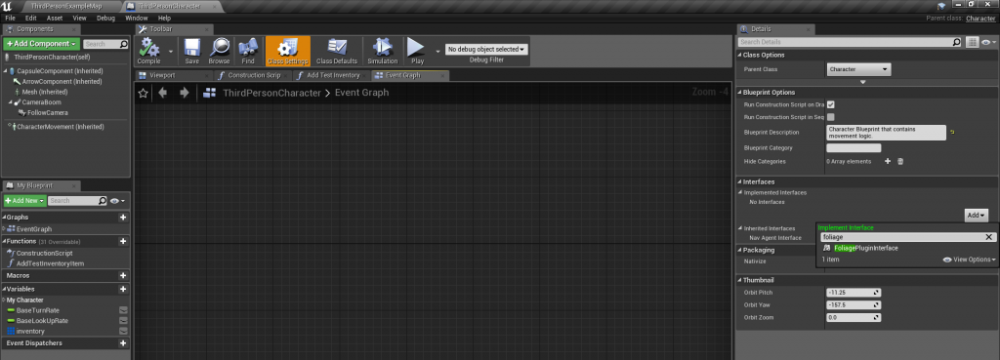
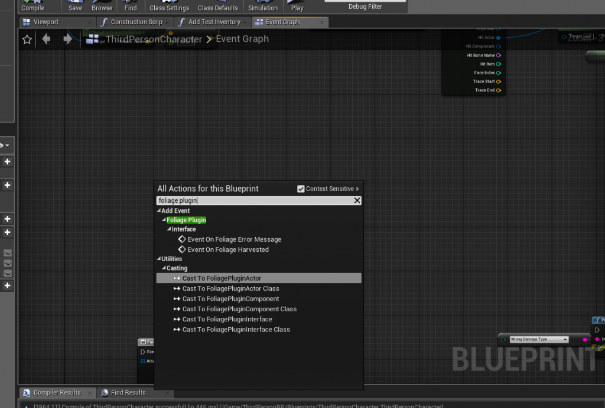
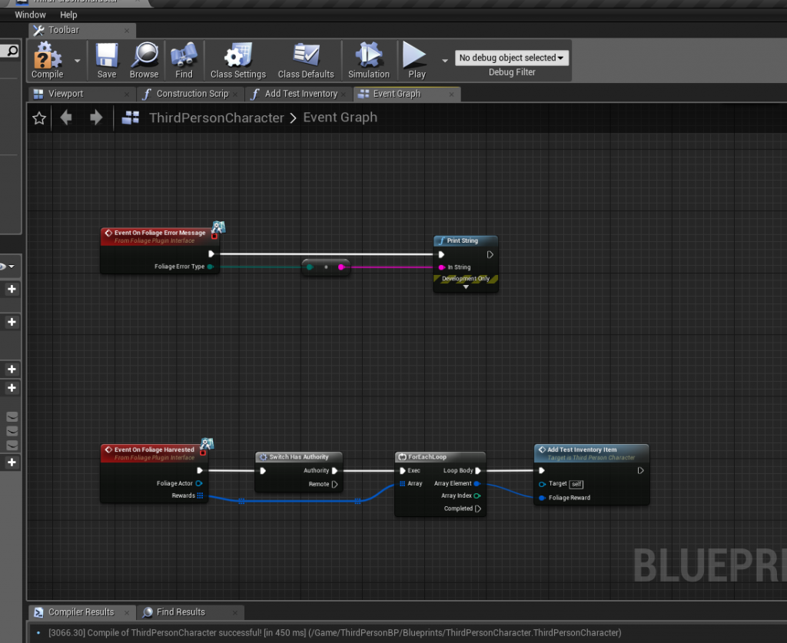
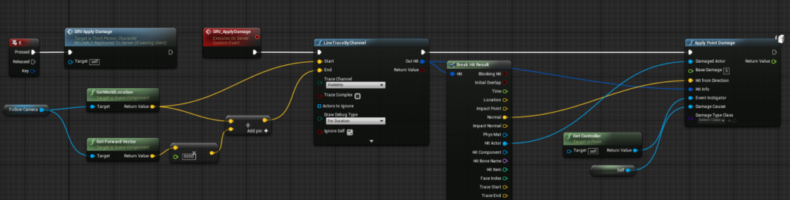

# Harvesting Foliage

## Step 1: Implement the Foliage Plugin Interface
When foliage is harvested, the plugin sends the rewards to the **Instigator** (the Controller passed to the damage node) and to the **Damage Causer**. Whichever of them implements the **Foliage Plugin Interface** receives the events.

Open your Player Controller, or the Actor you pass as Damage Causer such as your Character, and add **Foliage Plugin Interface** under **Class Settings → Implemented Interfaces**.

This unlocks two events:

| Event | Called when |
|---|---|
| **On Foliage Harvested** | The foliage was harvested. Receives the Foliage Actor and its **Rewards**. |
| **On Foliage Error Message** | The foliage could not be harvested, for example because the wrong [damage type](/docfiles/guides/damage-types) was used. |

See [Foliage Plugin Interface](/docfiles/reference/foliage-plugin-interface) for details.

## Step 2: Add the rewards to your inventory
Each reward has a **Reward Name** and a **Number of Rewards** with a **Min** and **Max** value. Pick an amount between Min and Max, for example with **Random Integer in Range**, and add it to your own inventory system.

:::info
The interface events run on the **server**. Update a replicated inventory from here, and the clients will see the change.
:::

## Step 3: Apply damage to the foliage
Apply **point damage** or **radial damage** to the foliage, on the server. This example does a line trace from the player's view and calls **Apply Point Damage** on the hit:

The plugin handles the rest. The first hit replaces the instance with your Foliage Actor and applies the same damage to it, so the first hit already counts as a harvest.

:::warning Damage must be applied on the server
Damage applied on a client is ignored. In multiplayer, send a Server RPC from the client and apply the damage there. See [Multiplayer](/docfiles/concepts/multiplayer).
:::

## Next steps
- Read [Lifecycle of a Foliage Instance](/docfiles/concepts/lifecycle) to understand uses, lifetimes and respawning.
- Require tools for harvesting with [Damage Types](/docfiles/guides/damage-types).
- Make trees fall over with [Simulating Physics](/docfiles/guides/simulating-physics).
