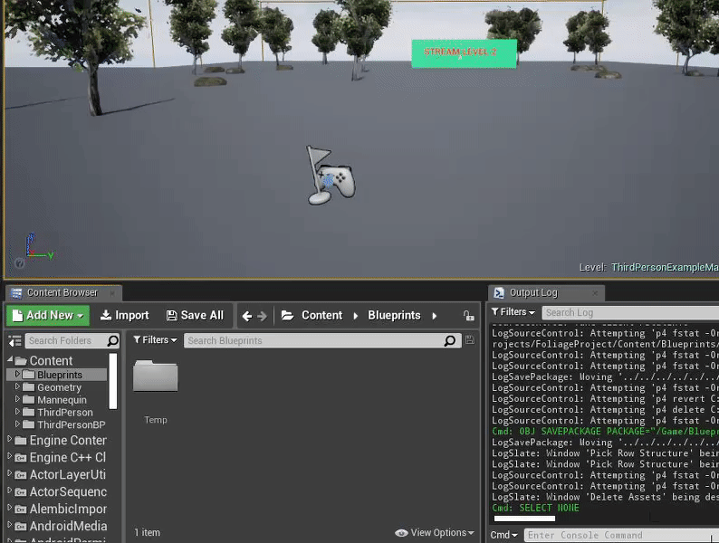
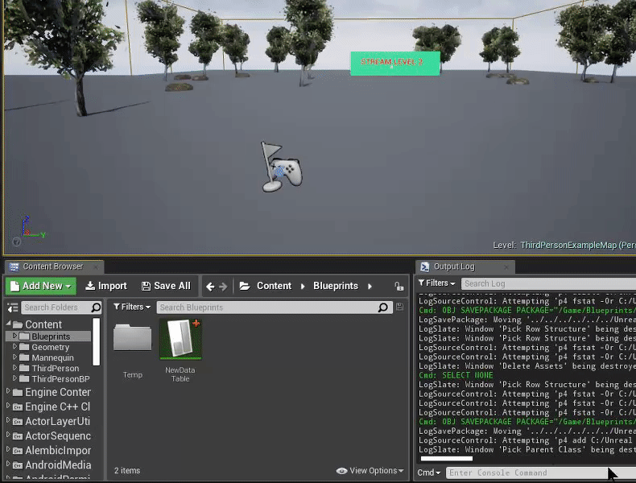
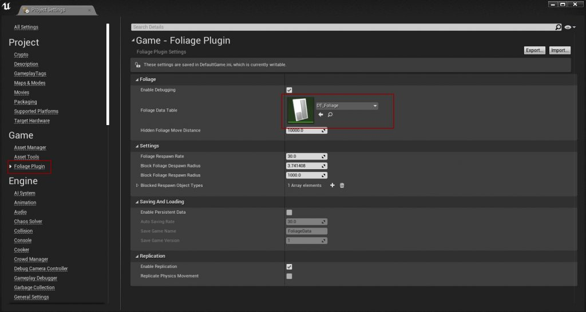
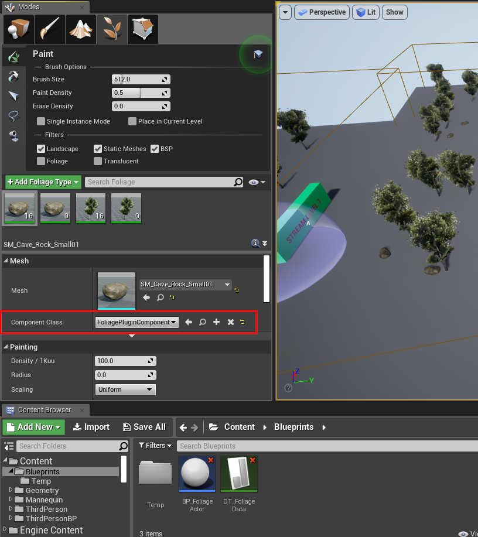
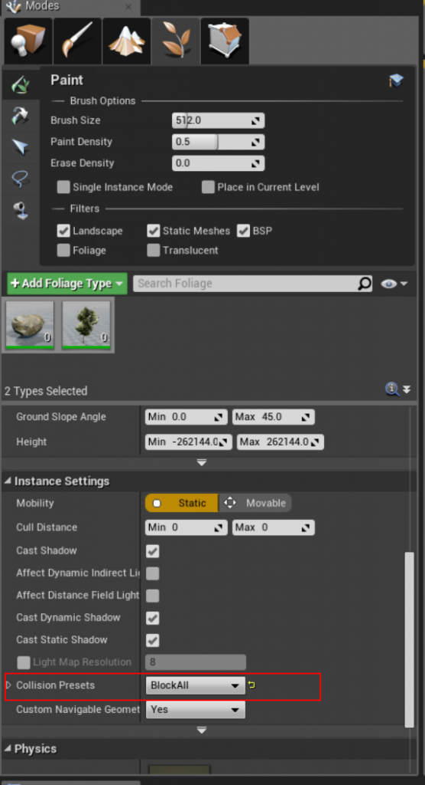
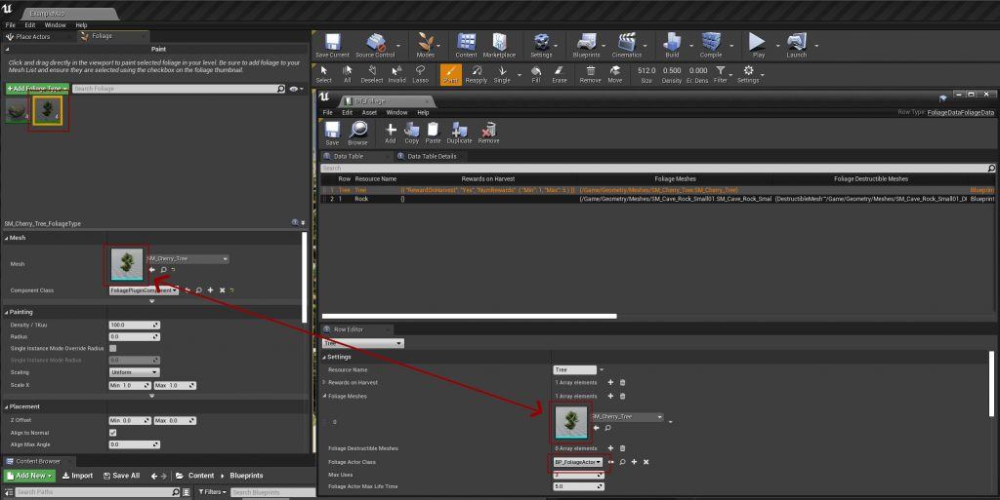

# Setting up Foliage

This page sets up a harvestable **Tree**. The same steps apply to rocks, bushes or anything else you paint as foliage.

## Step 1: Create a Foliage Data Table
The Data Table holds every resource the plugin can interact with. Create a new **Data Table** and pick **FoliageData** as the row structure. In the examples it is called `DT_Foliage`.

## Step 2: Create a Foliage Actor
The Foliage Actor is the Actor that replaces a foliage instance when the instance takes damage. Create a new Blueprint class with **FoliagePluginActor** as the parent class. In the examples it is called `BP_FoliageActor`.

You can use one Foliage Actor for every resource, or create a separate one per resource. See [Foliage Actor](/docfiles/reference/foliage-actor) for the events and functions you can override.

## Step 3: Assign the Data Table in the Project Settings
Open **Project Settings → Game → Foliage Plugin** and set **Foliage Data Table** to the Data Table you created in Step 1.

See [Plugin Settings](/docfiles/reference/plugin-settings) for every other setting.

## Step 4: Use the Foliage Plugin Component on your foliage types
Open the foliage type of every mesh you want to interact with, and set **Component Class** to **FoliagePluginComponent**.

:::warning
Instances that use the default component class are ignored by the plugin.
:::

To harvest instances spawned by PCG or added to your own Actor, see [PCG and Instanced Static Meshes](/docfiles/guides/pcg-and-instanced-meshes).

## Step 5: Configure collision
The foliage must block the trace or projectile you use to apply damage. This example uses **BlockAll**. In a real project you will probably want your own collision profile.

Also make sure the mesh itself has simple collision. See [Collision Setup](/docfiles/guides/collision-setup).

## Step 6: Add the resource to the Data Table
Add a row to the Data Table for the tree:

- Add the tree's static mesh to **Foliage Meshes**. It must be the **same mesh** as the one you paint, this is how the plugin knows which row a foliage instance belongs to.
- Set **Foliage Actor Class** to the Foliage Actor from Step 2.
- Add the rewards the player should get to **Rewards on Harvest**.

See [Data Table Settings](/docfiles/reference/data-table-settings) for every column.

## Next step
[Set up your character to harvest foliage](/docfiles/getting_started/harvesting).
