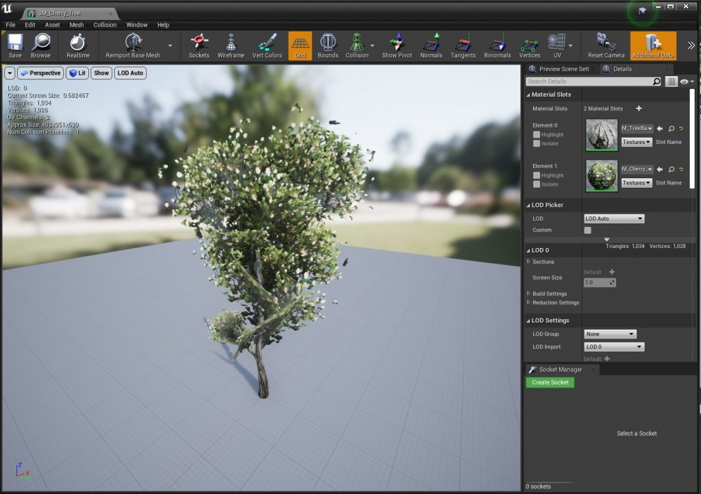
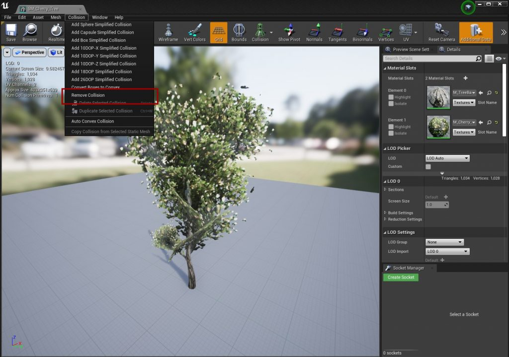
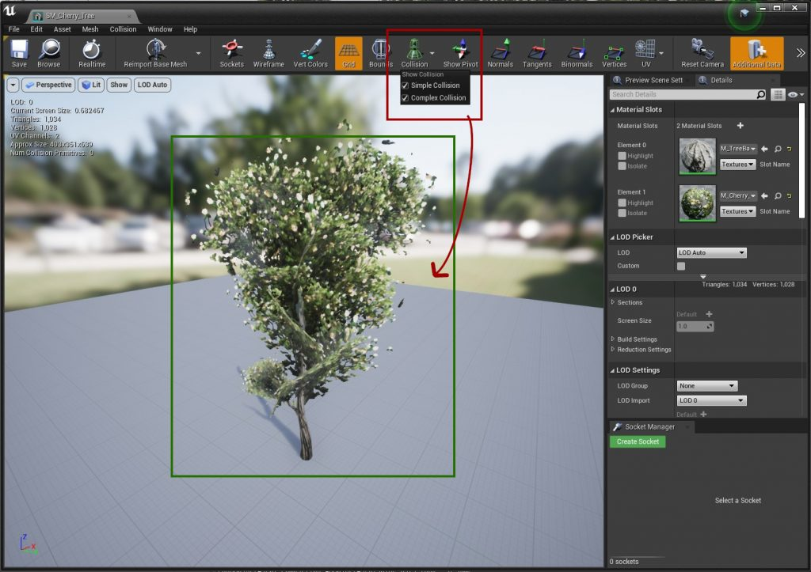
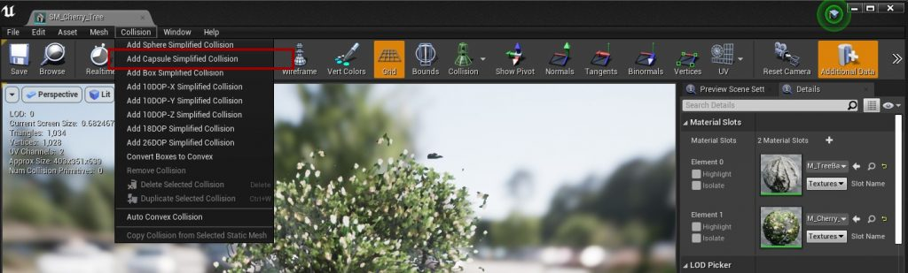
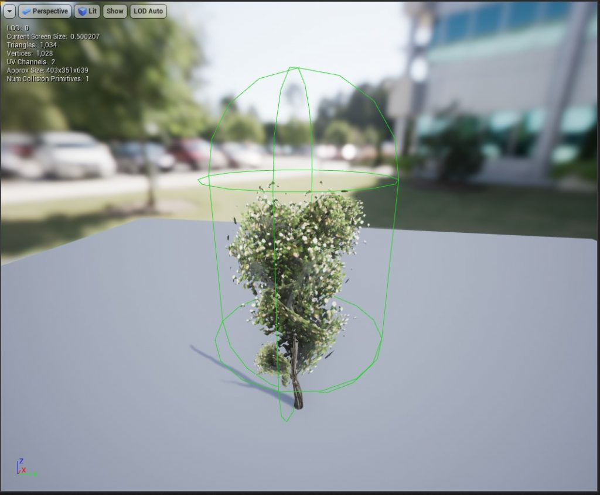
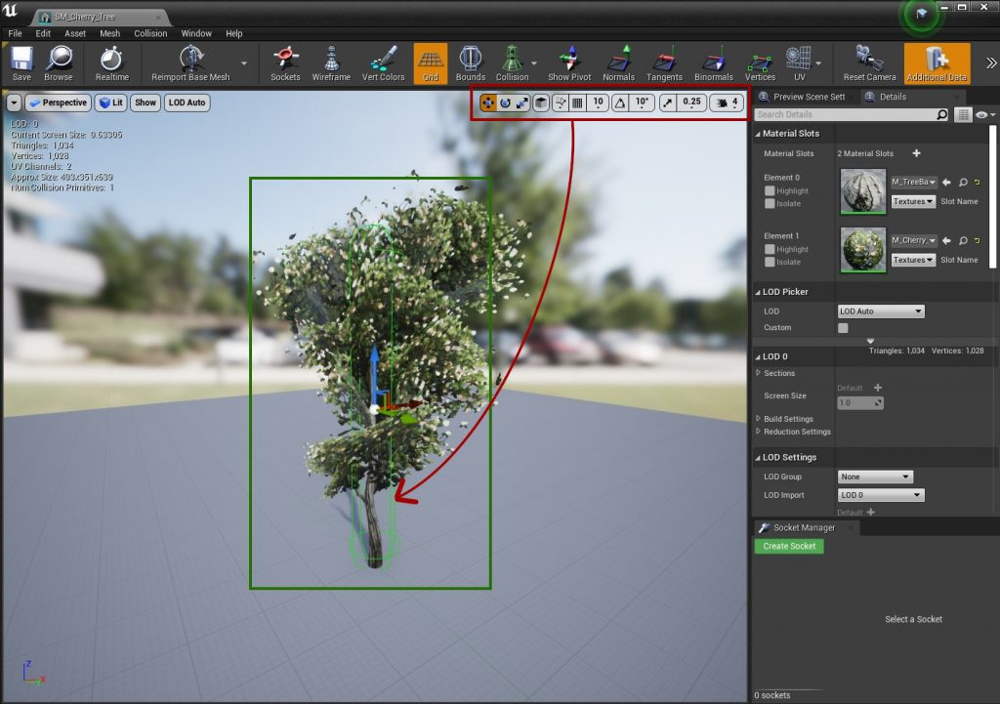

# Collision Setup

Good collision matters for every game, and especially when meshes simulate physics: complex collision is **very expensive** to simulate. This example sets up a simple capsule collision on a tree. It will not fit every mesh, but it is a good starting point.

## Step 1: Open the mesh
Open the static mesh in the Static Mesh Editor.

## Step 2: Remove the existing collision
Remove all collision on the mesh, so you can add your own simple collision. Do not use complex collision here.

Turn on **Simple Collision** and **Complex Collision** in the viewport's **Show** menu. The mesh should show no collision outlines.

## Step 3: Add a simple collision
Add a capsule collision from the **Collision** menu.

The capsule is usually too big at first:

Use the transform tools to scale and move the capsule so it fits the trunk. Simple is better than exact.

Save the mesh. It now has collision that works for both interaction and physics.
