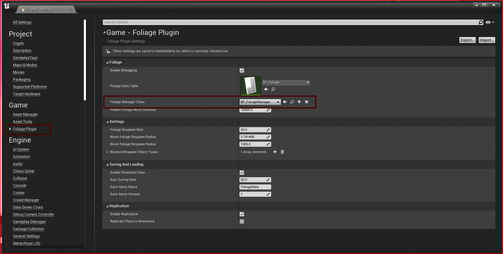
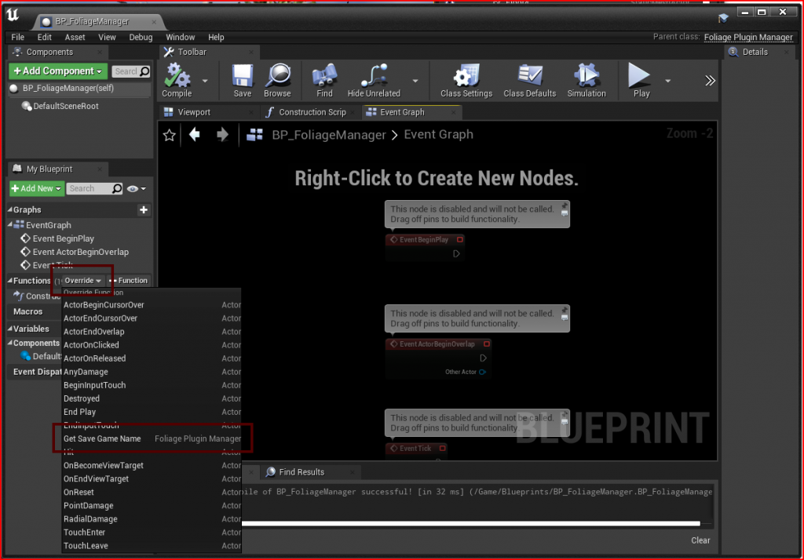
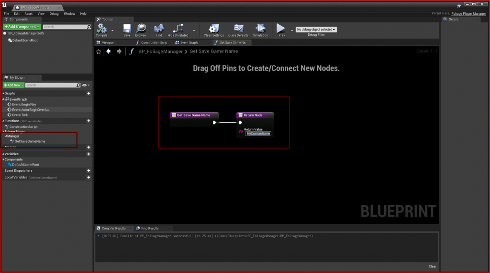

# Custom Foliage Manager

The **Foliage Manager** keeps track of hidden and removed instances, respawns them, replicates them and saves them. It is spawned automatically on the server. You can replace it with your own subclass to customize saving.

## Step 1: Create the class
Create a Blueprint class with **FoliagePluginManager** as the parent class, and set it as **Foliage Manager Class** in **Project Settings → Game → Foliage Plugin**.

## Step 2: Override the functions you need
| Function | Use it to |
|---|---|
| **Get Save Game Name** | Return the save slot name to use, for example one per map or per save file. Overrides **Save Game Name** in the Project Settings. |
| **Save Foliage Data to Disk** | Replace how the data is saved. Return true on success. Also called when the manager ends play if there are unsaved changes. Check **Is Saving Synchronously** to finish the save before you return. |

Return the name you want to use:

See [Saving and Loading](/docfiles/concepts/saving-and-loading) for how saving works.
