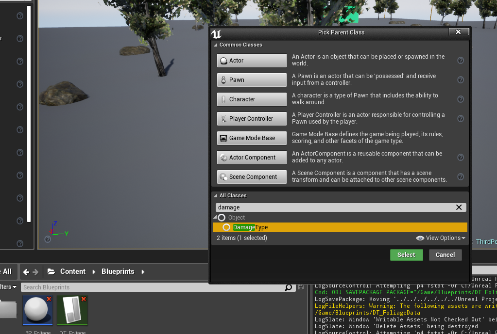
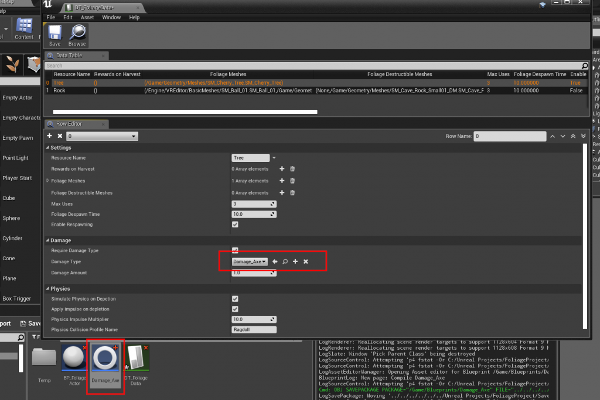
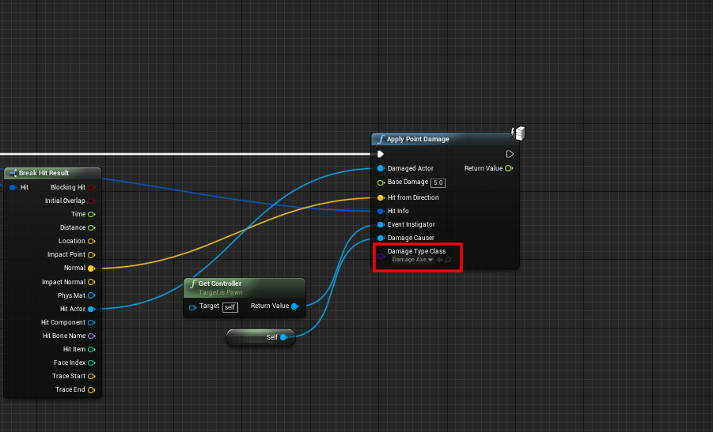

# Damage Types

Damage types decide what kind of damage is needed to harvest a resource, for example an **axe** for trees and a **pickaxe** for rocks.

## Step 1: Create a Damage Type
Create a new Blueprint class with **DamageType** as the parent class, for example `Damage_Axe`.

## Step 2: Require it in the Data Table
In the resource's row in the [Foliage Data Table](/docfiles/reference/data-table-settings):

1. Turn on **Require Damage Type**.
2. Add your damage type to **Valid Damage Types**. You can add several, for example an axe and a chainsaw.
3. Optionally set **Damage Amount** to the minimum damage a hit must do.

## Step 3: Apply damage with that type
Pass your damage type as **Damage Type Class** when you apply damage:

## How the check works
When **Require Damage Type** is on, a hit counts only if:

- the damage type is **exactly** one of the **Valid Damage Types** (child classes of a valid type do not count), and
- the damage is at least **Damage Amount**.

If **Valid Damage Types** is empty, only the damage amount is checked.

A hit that fails the check does nothing, and **On Foliage Error Message** is sent to the Instigator and the Damage Causer:

- **Wrong Damage Type** if the damage type is not in **Valid Damage Types**. Use it to show a message such as *"You need an axe"*.
- **Not Enough Damage** if the damage type is valid but the damage is less than **Damage Amount**.

 See [Foliage Plugin Interface](/docfiles/reference/foliage-plugin-interface).

When **Require Damage Type** is off, any damage above 0 harvests the resource.
