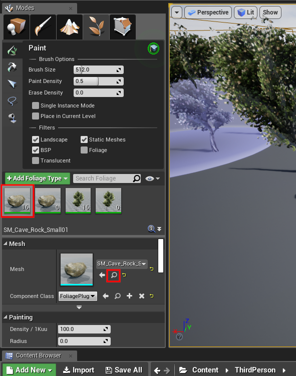
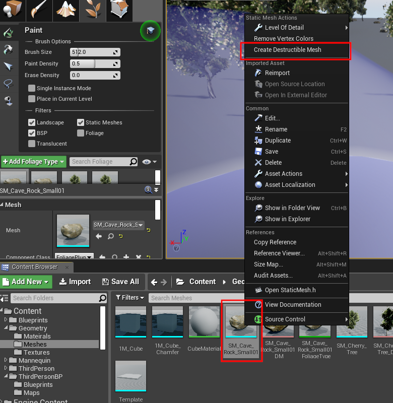
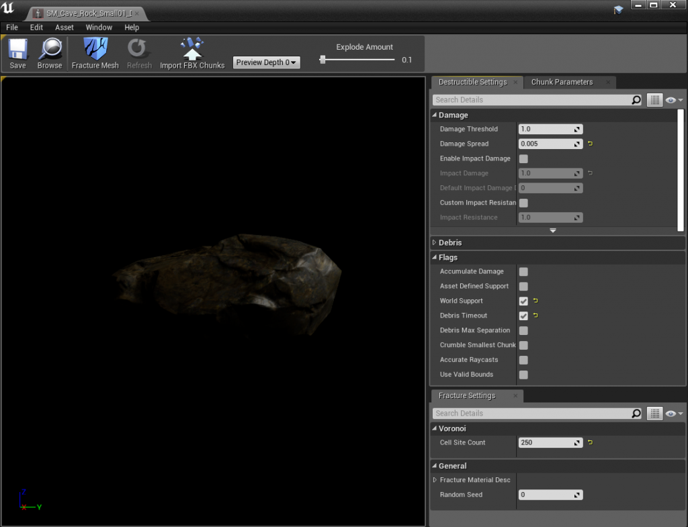
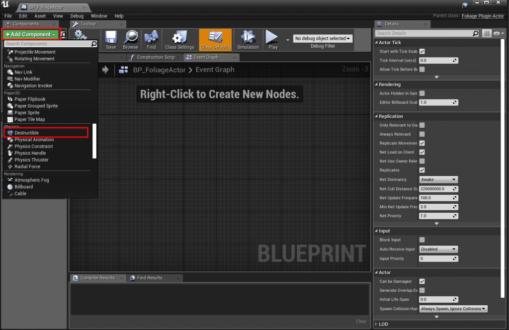

# Destructible Meshes

A resource can have a destructible version of its mesh that breaks apart when it is harvested.

| Engine | Asset | Component on the Foliage Actor |
|---|---|---|
| Unreal Engine 5 | **Geometry Collection** (Chaos) | **Geometry Collection Component** |
| Unreal Engine 4 | **Destructible Mesh** (Apex) | **Destructible Component** |

## Step 1: Create the destructible asset
Create the destructible version from the same static mesh that you paint as foliage.

- **Unreal Engine 5**: select the mesh in a level and create a Geometry Collection with **Fracture Mode**.
- **Unreal Engine 4**: right-click the mesh in the Content Browser and select **Create Destructible Mesh**, as in the screenshots below.

Find the foliage mesh in the Content Browser:

Create the Destructible Mesh:

Example settings for a destructible rock:

## Step 2: Add it to the Data Table
Add the asset to **Destructible Meshes** in the resource's row.

:::warning Same index as the Foliage Mesh
The destructible asset must have the **same index** in **Destructible Meshes** as its mesh has in **Foliage Meshes**. Leave an entry empty if a mesh has no destructible version.
:::

In this example, the rock at index 1 has a destructible version at index 1, and the mesh at index 0 has none:

## Step 3: Add the component to the Foliage Actor
Open your Foliage Actor Blueprint and add a **Geometry Collection Component** (UE5) or a **Destructible Component** (UE4).

The plugin now handles damage and visibility of the destructible mesh:

## Unreal Engine 5: Field System Actor
In Unreal Engine 5, the Geometry Collection is broken by spawning a **Field System Actor** at the hit location. The default is the engine's `FS_MasterField`. You can choose another one with **Field System Actor** in the [Plugin Settings](/docfiles/reference/plugin-settings).

To apply the damage in your own way, override **Handle Destructible Damage** in your Foliage Actor. See [Foliage Actor](/docfiles/reference/foliage-actor).

:::info
[Simulating physics on depletion](/docfiles/guides/simulating-physics) is disabled for resources that have a destructible mesh.
:::
