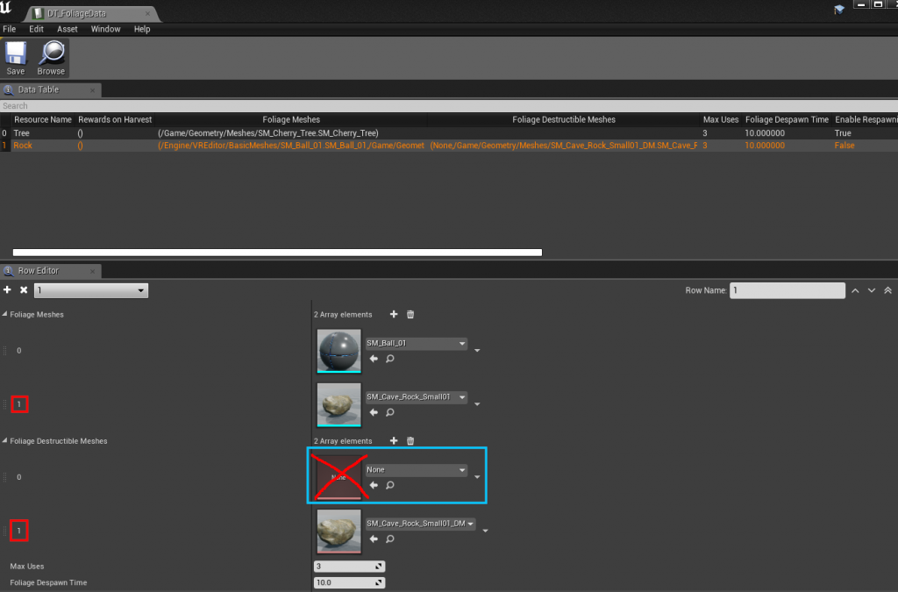
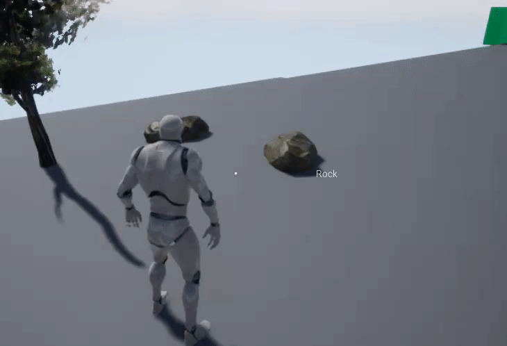

# Destructible Meshes

A resource can have a destructible version of its mesh that breaks apart when it is harvested. The plugin uses Chaos **Geometry Collections** for this.

## Step 1: Create a Geometry Collection
Create the Geometry Collection from the same static mesh that you paint as foliage:

1. Place the static mesh in a level and select it.
2. Switch to **Fracture Mode** and click **New** to create a Geometry Collection asset from it.
3. Fracture it, for example with **Uniform** or **Cluster**, and save the asset.

## Step 2: Add it to the Data Table
Add the Geometry Collection to **Destructible Meshes** in the resource's row.

:::warning Same index as the Foliage Mesh
The Geometry Collection must have the **same index** in **Destructible Meshes** as its mesh has in **Foliage Meshes**. Leave an entry empty if a mesh has no destructible version.
:::

In this example, the rock at index 1 has a destructible version at index 1, and the mesh at index 0 has none:

## Step 3: Add the component to the Foliage Actor
Open your Foliage Actor Blueprint and add a **Geometry Collection Component**. The plugin now handles damage and visibility of the destructible mesh:

## Geometry Collection Actor
The destructible mesh is shown by a separate **Foliage Plugin Geometry Collection Actor** that is spawned on the server and on every client. It uses the Foliage Actor's location, rotation and scale, and the Foliage Actor's own mesh is hidden while it is shown. Point and radial damage on it is passed on to the Foliage Actor, so a hit counts just like a hit on the Foliage Actor.

You can read the resource from it:

| Function | Returns |
|---|---|
| **Get Foliage Actor** | The Foliage Actor it belongs to. |
| **Foliage Get Data** | The resource's row from the Data Table. It is copied, so it is still there after the Foliage Actor is destroyed. |
| **Foliage Get Mesh Index** | The index of the mesh in **Foliage Meshes**. |

To add your own logic, create a Blueprint with **Foliage Plugin Geometry Collection Actor** as the parent class and set it as **Geometry Collection Actor Class** in the [Plugin Settings](/docfiles/reference/plugin-settings). The Foliage Actor and the data are set before **Begin Play**. From the Foliage Actor, use **Get Geometry Collection Actor** to find it.

The Geometry Collection Actor is destroyed together with the Foliage Actor.

## Field System Actor
The Geometry Collection is broken by spawning a **Field System Actor** at the hit location. It is spawned on the server and on every client. The default is **FoliagePluginFieldSystemActor**, which applies a strain at the hit location when it spawns:

| Setting | Default | Description |
|---|---|---|
| **Field Radius** | `200` | Radius around the hit location that is affected. |
| **Strain Magnitude** | `500000` | Strain that breaks the Geometry Collection. It must be higher than the **Damage Threshold** of the Geometry Collection. |
| **Strain Cluster Levels** | `1` | Number of cluster levels the strain breaks. |
| **Force Magnitude** | `0` | Force that pushes the broken pieces away from the hit location. 0 applies no force. |

To change these values, create a Blueprint with **FoliagePluginFieldSystemActor** as the parent class and set it as **Field System Actor** in the [Plugin Settings](/docfiles/reference/plugin-settings). You can also use any other Field System Actor. If you use your own, set **Replicates** to off, because every machine already spawns its own.

:::warning Upgrading from an older version
Older versions used the engine's `FS_MasterField`, which is an editor asset and may be missing in packaged builds. If your **Field System Actor** setting still points to `FS_MasterField`, reset it to the default.
:::

To apply the damage in your own way, override **Handle Destructible Damage** in your Foliage Actor. See [Foliage Actor](/docfiles/reference/foliage-actor).

:::info
[Simulating physics on depletion](/docfiles/guides/simulating-physics) is disabled for resources that have a destructible mesh.
:::
