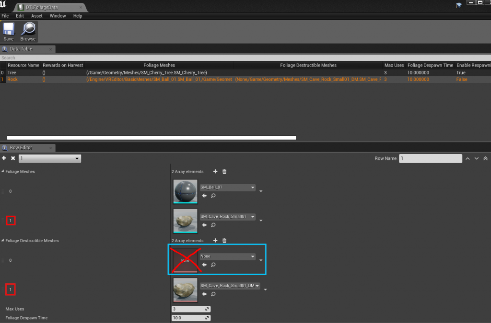
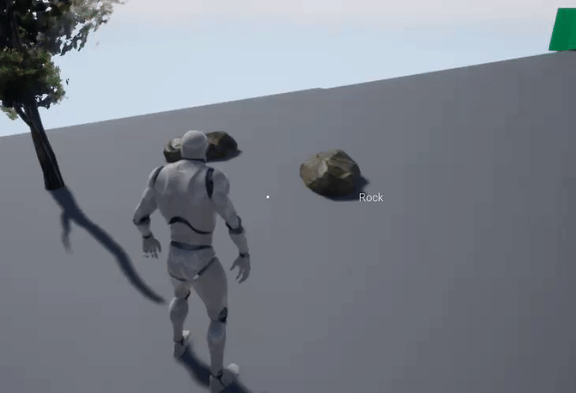

# Destructible Meshes

A resource can have a destructible version of its mesh that breaks apart when it is harvested. The plugin uses Chaos **Geometry Collections** for this.

## Step 1: Create a Geometry Collection
Create the Geometry Collection from the same static mesh that you paint as foliage:

1. Place the static mesh in a level and select it.
2. Switch to **Fracture Mode** and click **New** to create a Geometry Collection asset from it.
3. Fracture it, for example with **Uniform** or **Cluster**, and save the asset.

## Step 2: Add it to the Data Table
Add the Geometry Collection to **Destructible Meshes** in the resource's row.

:::warning Same index as the Foliage Mesh
The Geometry Collection must have the **same index** in **Destructible Meshes** as its mesh has in **Foliage Meshes**. Leave an entry empty if a mesh has no destructible version.
:::

In this example, the rock at index 1 has a destructible version at index 1, and the mesh at index 0 has none:

## Step 3: Add the component to the Foliage Actor
Open your Foliage Actor Blueprint and add a **Geometry Collection Component**. The plugin now handles damage and visibility of the destructible mesh:

## Field System Actor
The Geometry Collection is broken by spawning a **Field System Actor** at the hit location. The default is the engine's `FS_MasterField`. You can choose another one with **Field System Actor** in the [Plugin Settings](/docfiles/reference/plugin-settings).

To apply the damage in your own way, override **Handle Destructible Damage** in your Foliage Actor. See [Foliage Actor](/docfiles/reference/foliage-actor).

:::info
[Simulating physics on depletion](/docfiles/guides/simulating-physics) is disabled for resources that have a destructible mesh.
:::
