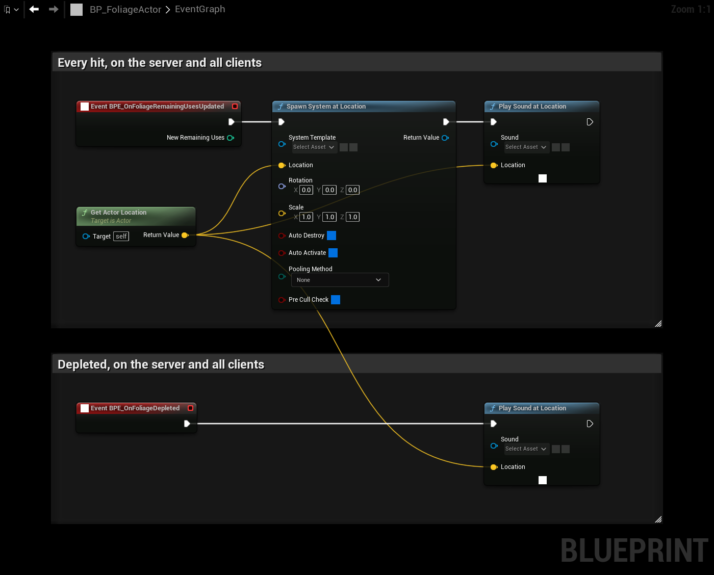

# Effects and Sounds

Play effects from the events that run on the server **and** on every client. Then every player sees and hears them, without any extra replication.

| Event | Use it for |
|---|---|
| **BPE On Foliage Remaining Uses Updated** | Every hit: wood chips, a chop sound. |
| **BPE On Foliage Depleted** | When the resource runs out: a cracking sound, falling leaves. |

**BPE On Foliage Damaged** only runs on the server, so effects played from it are only seen by the host.

## Step 1: Paste the events
Open your Foliage Actor and paste these nodes into the **Event Graph**:

If the graph already has one of these events, the paste creates a duplicate. Delete your existing event first, or move its nodes over.

## Step 2: Choose the assets
- On **Spawn System at Location**, set **System Template** to the Niagara system for a hit.
- On the first **Play Sound at Location**, set **Sound** to the hit sound.
- On the second **Play Sound at Location**, set **Sound** to the sound for when the resource runs out.

The effects play at the location of the Foliage Actor, which is the base of the mesh. Add an offset to the location if you want them higher up, for example at the height of the axe.

## Different effects per resource
One Foliage Actor is often used for trees, rocks and bushes. To play different effects per resource, store the effects in variables on separate Foliage Actor children, one per resource, or pick them from the mesh in **BPE On Foliage Mesh Updated**.

## Good to know
- **BPE On Foliage Remaining Uses Updated** also runs when the remaining uses change for another reason, for example from **Add Remaining Uses**.
- A player who comes close to a tree that was hit earlier receives its remaining uses when the actor replicates to them, and the event runs for that player as well. Keep effects short, so this is not noticed.
- On a dedicated server, the effects and sounds are not needed. Use **Is Dedicated Server** to skip them there if you want to.
