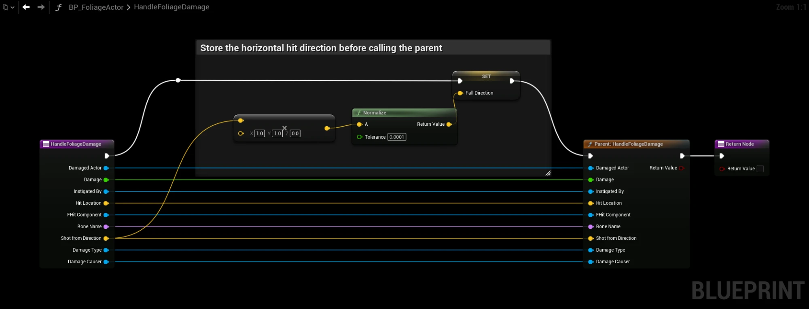
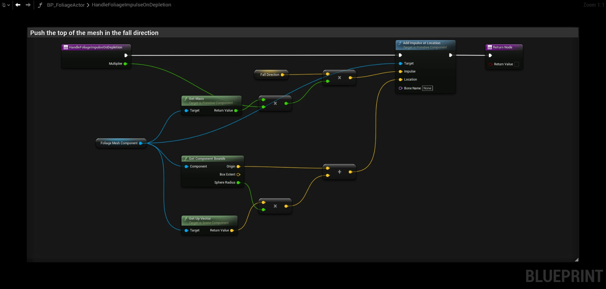

# Falling Away from the Player

By default, a depleted tree is pushed in a random direction. This guide makes it fall in the direction it was hit from, so it falls away from the player, or away from an explosion. The direction is replicated, so the tree falls the same way for every player.

Set up [Simulating Physics](/docfiles/guides/simulating-physics) first, with **Simulate Physics on Depletion** and **Apply Impulse on Depletion** turned on.

## Step 1: Add a Fall Direction variable
Open your Foliage Actor and add a **Vector** variable called **FallDirection**. In its details, set **Replication** to **Replicated**.

## Step 2: Store the hit direction
Under **Override** in the **My Blueprint** panel, override **Handle Foliage Damage**. Right-click the function entry and choose **Add Call to Parent Function**, then paste the nodes:

1. Connect the exec pin of the function entry to **Set FallDirection**, **Set FallDirection** to **Parent: Handle Foliage Damage**, and the parent to the **Return Node**. The editor connects the parent directly to the function entry, so move the parent after **Set FallDirection**.
2. Connect every pin of the function entry to the matching pin on the parent.
3. Connect **Shot From Direction** of the function entry to the **A** pin of the multiply node.

The multiply node removes the up and down part of the direction, so the tree is pushed sideways and not into the ground.

:::warning
Without the parent call, the Foliage Actor no longer gives rewards or loses uses. Set **FallDirection** before the parent is called: the parent reduces the remaining uses, and the tree falls as soon as they reach 0.
:::

## Step 3: Push the tree in that direction
Override **Handle Foliage Impulse on Depletion**. Delete the **Parent** node if there is one, and paste:

1. Connect the exec pin of the function entry to **Add Impulse at Location**, and **Add Impulse at Location** to the **Return Node**.
2. Connect **Multiplier** of the function entry to the **B** pin of the float multiply node.

The impulse is applied near the top of the mesh and scaled by the mesh's mass and the **Physics Impulse Multiplier** of the row, the same way as the default.

## How it works
**Handle Foliage Damage** only runs on the server, and stores the direction in the replicated variable. **Handle Foliage Impulse on Depletion** runs on the server and on every client when the tree is depleted. The variable is replicated together with the remaining uses, so every client already has the direction when the tree starts to fall.

Each player still simulates the fall on their own unless **Replicate Physics Movement** is on, but the tree now falls the same way for everyone. See [Physics movement](/docfiles/concepts/multiplayer#physics-movement).

## Troubleshooting
- **The tree falls straight down.** **FallDirection** is zero. Make sure your damage passes a direction: **Hit From Direction** on **Apply Point Damage**. Radial damage always has a direction.
- **The tree only falls the right way on the server.** **FallDirection** is not set to **Replicated**.
- **The tree does not fall over.** Increase **Physics Impulse Multiplier** in the Data Table.
