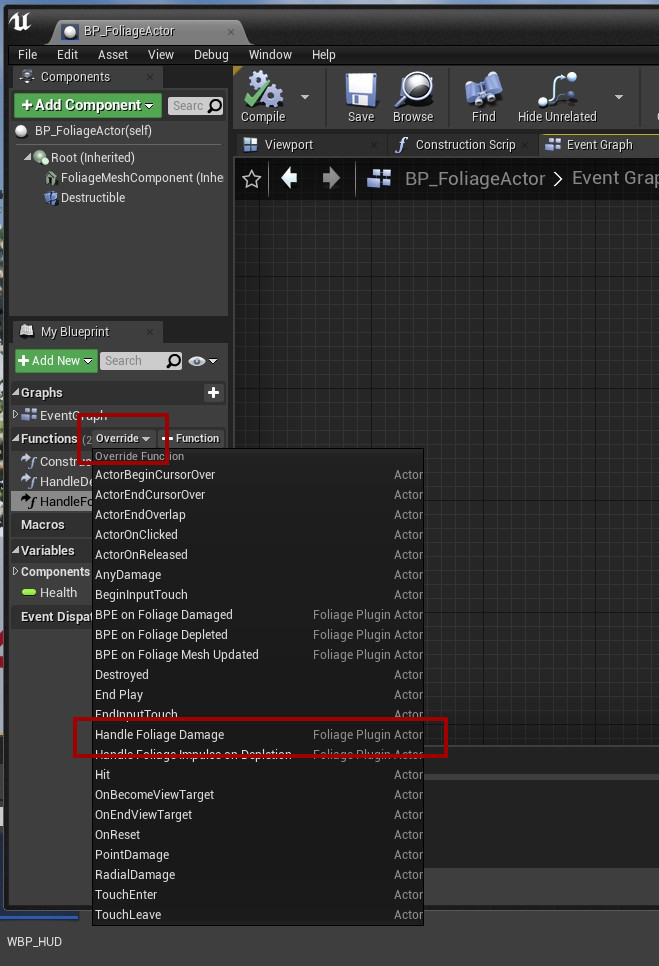
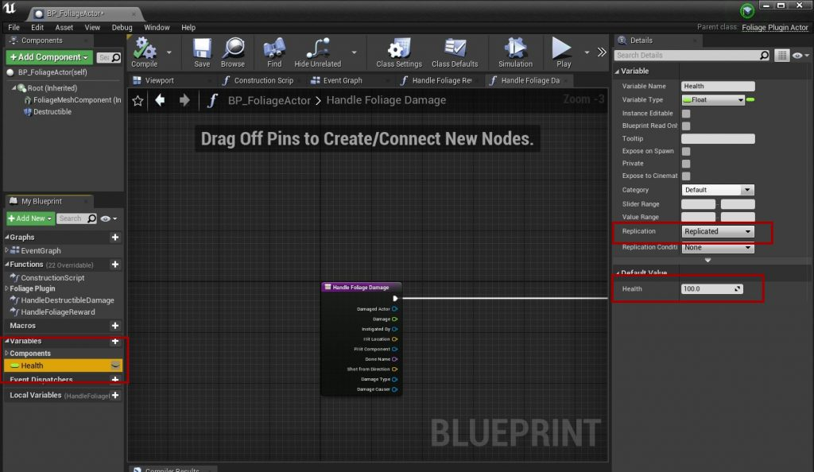
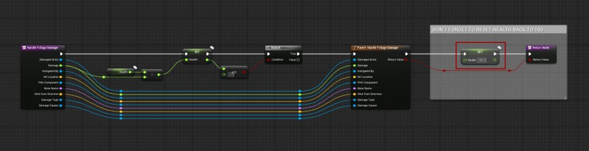
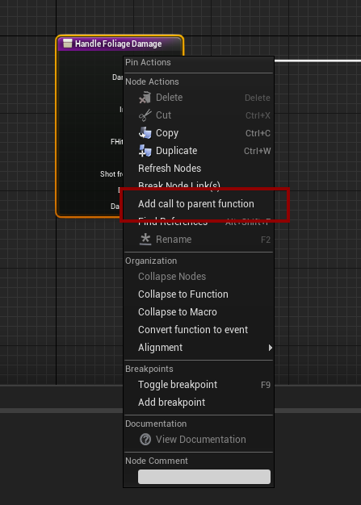

# Health

By default, every hit on a Foliage Actor gives the player a reward. This example adds a **Health** value instead: the player has to hit the tree until its health reaches 0 before getting the reward.

## Step 1: Override Handle Foliage Damage
Open your Foliage Actor Blueprint and override the **Handle Foliage Damage** function. This replaces the default damage handling with your own logic.

## Step 2: Add a Health variable
Add a **Health** variable of type **Float** with a default value of **100**. Make it **Replicated** if you are making a multiplayer game.

## Step 3: Reduce health and call the parent
In **Handle Foliage Damage**, subtract the damage from **Health**. When it reaches 0:

1. Reset **Health** to 100, so the next use starts over.
2. Call the parent function. It gives the reward and reduces the remaining uses.

Add the **Parent: Handle Foliage Damage** node by right-clicking the function entry node and selecting **Add call to parent function**.

:::info
**Handle Foliage Damage** only runs on the server, so the health check is server authoritative.
:::
