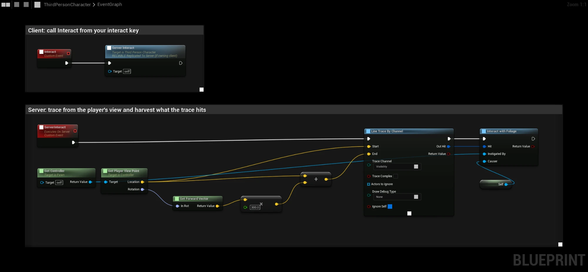
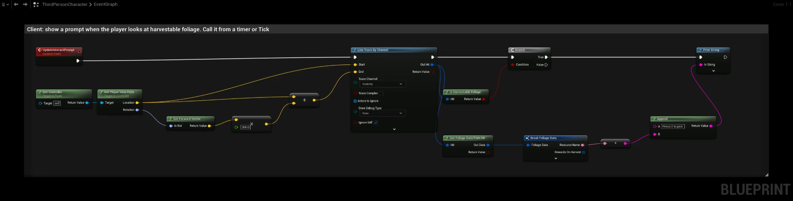
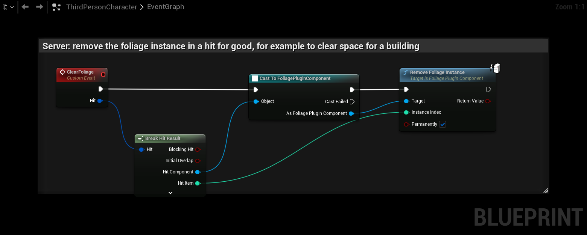

# Interaction and Pickups

Not everything is harvested with an axe. Berries, mushrooms, flowers and loose stones are picked up with an interact key. The plugin supports this in two ways:

- **Interaction:** harvest an instance or a Foliage Actor without damage. Everything else works the same as with damage: uses, rewards, lifetimes and respawning.
- **Pickups:** give the rewards and hide the instance right away, without spawning a Foliage Actor at all.

## Interacting with foliage
Call **Interact With Foliage** on the **server** with the hit result of a trace:

| Pin | Value |
|---|---|
| **Hit** | The **Out Hit** of your trace. Works for a foliage instance, a Foliage Actor and the actor of a [destructible mesh](/docfiles/guides/destructible-meshes). |
| **Instigated By** | The Controller. Receives the rewards if it implements the [Foliage Plugin Interface](/docfiles/reference/foliage-plugin-interface). |
| **Causer** | The Actor that interacts, for example your Character. |

It returns true if something was harvested.

An interaction counts as one harvest. On an instance it spawns the Foliage Actor and harvests it once, just like the first hit with damage. On a Foliage Actor it calls **Interact**, which gives the rewards, reduces the remaining uses by 1 and calls **BPE On Foliage Interacted**.

The **Require Damage Type** check is skipped for interactions. To stop a resource from being harvested by interaction, for example trees, turn off **Allow Interaction** in its [Data Table](/docfiles/reference/data-table-settings#interaction) row.

### Multiplayer
Do it the same way as damage in [Multiplayer Harvesting](/docfiles/guides/multiplayer-harvesting): the client sends a Server RPC, the server traces and calls **Interact With Foliage** with the **Out Hit**. Calls on a client do nothing.

In this example in the Character, the interact key calls **Interact** on the client. **ServerInteract** is a custom event set to **Run on Server** and **Reliable**. It traces 300 units from the player's view and harvests what the trace hits:

### Showing an interaction prompt
**Is Harvestable Foliage** returns true if the hit is a foliage instance whose mesh is in the Data Table, or a Foliage Actor with uses left. It also works on clients, so you can use it with a trace from the player's view to show a prompt such as *Press E to pick*. **Get Foliage Data From Hit** returns the row, for example to show the **Resource Name**.

In this example, **UpdateInteractPrompt** is called from a timer or Tick on the client. It prints the prompt for one frame. In your game, show a widget instead:

## Pickups without a Foliage Actor
Turn on **Harvest Without Actor** in the row. The first hit or interaction then:

1. Sends **On Foliage Harvested** with the row's **Rewards on Harvest**. **Foliage Actor** is none, because no actor is spawned.
2. Hides the instance and shows the **Stump Mesh**, if the row has one.
3. Respawns the instance after **Respawn Delay**, or removes it for good if **Enable Respawning** is off.

**Max Uses**, the lifetimes, the physics settings and **Foliage Actor Class** are not used. Damage still has to pass the **Require Damage Type** check.

This is the cheapest way to harvest: nothing is spawned, and only the instance change is replicated.

:::tip Berry bushes
Use the bush without berries as **Stump Mesh** and a few minutes of **Respawn Delay**. Picking the bush gives berries and leaves an empty bush that grows back. Add a **Regrow Duration** to let the berries grow back slowly. See [Stumps and Regrowth](/docfiles/guides/stumps-and-regrowth).
:::

## Removing instances from Blueprint
**Remove Foliage Instance** on a **FoliagePluginComponent** hides an instance without rewards, for example to clear space for a building. With **Permanently** on, it is removed for good, otherwise it respawns like a harvested instance. Use **Hit Component** and **Hit Item** from the hit result as the component and the instance index. See [Blueprint Functions](/docfiles/reference/blueprint-functions#foliage-plugin-component).

