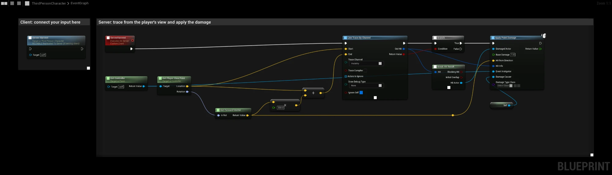

# Multiplayer Harvesting

Foliage only reacts to damage on the server. In multiplayer, the client sends a Server RPC, and the server does the line trace and applies the damage. This works the same on a listen server and a dedicated server, and also in single player.

This guide adds the logic to your Character Blueprint.

## Step 1: Create the Server RPC
Add a **Custom Event** called **Server Harvest**. In its details, set **Replicates** to **Run on Server** and check **Reliable**.

When a client calls the event, it runs on the server. When the server calls it, it runs right away.

## Step 2: Call it from your input
Connect your harvest input, for example the attack or interact action, to a call of **Server Harvest**. Do not send the hit result or the hit actor to the server. The server does its own trace.

## Step 3: Trace from the player's view on the server
From **Server Harvest**:

1. Call **Get Controller**, and on it **Get Player View Point**. On the server, this is the position and rotation of the player's camera.
2. Get the **Forward Vector** of the rotation, multiply it by the reach, for example `300`, and add it to the location. This is the end of the trace.
3. Call **Line Trace By Channel** from the location to the end.

The trace channel must be blocked by the foliage. See [Collision Setup](/docfiles/guides/collision-setup).

## Step 4: Apply the damage
If the trace hit something, call **Apply Point Damage**:

| Pin | Value |
|---|---|
| **Damaged Actor** | **Hit Actor** from **Break Hit Result**. |
| **Base Damage** | The damage of the hit. |
| **Hit From Direction** | The forward vector from Step 3. |
| **Hit Info** | The **Out Hit** of the trace. The plugin uses it to find the instance that was hit. |
| **Event Instigator** | The Controller. It receives the [rewards](/docfiles/getting_started/harvesting) if it implements the Foliage Plugin Interface. |
| **Damage Causer** | **Self**. Also receives the rewards if it implements the interface. |
| **Damage Type Class** | The [damage type](/docfiles/guides/damage-types) of the tool, if you use them. |

## Why not trace on the client?
- The plugin only handles damage on the server, so damage applied on a client is ignored.
- Foliage spawned by PCG at runtime is created separately on each machine. A reference to it cannot be sent to the server, and arrives as none. The log then shows `FNetGUIDCache::SupportsObject ... NOT Supported`.
- A server trace also prevents clients from harvesting foliage they cannot reach.

## Next steps
- Play effects and sounds on all players from the replicated events. See [Multiplayer](/docfiles/concepts/multiplayer#events-on-clients).
- Require the right tool with [Damage Types](/docfiles/guides/damage-types).
