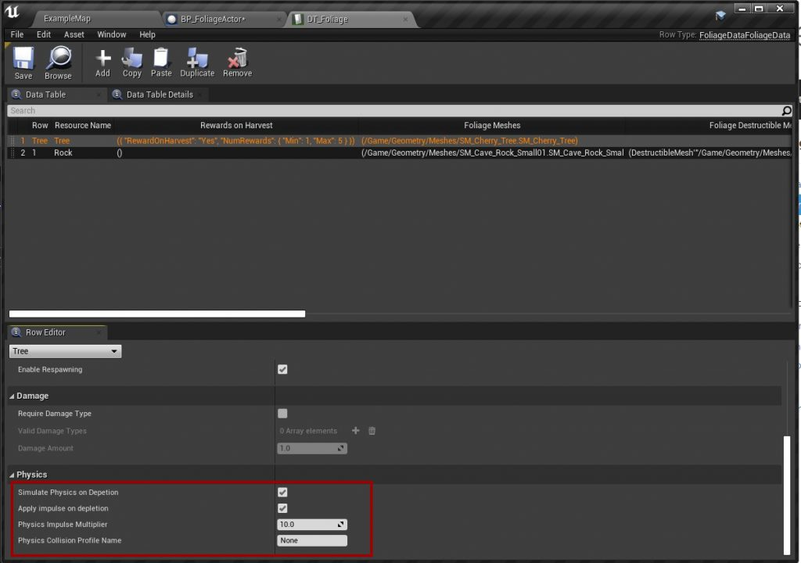

# Simulating Physics

To make a tree fall over when it has been harvested, let the Foliage Actor simulate physics on depletion.

## Step 1: Set up collision on the mesh
The mesh needs simple collision to simulate physics. Do this for **every** mesh that should simulate physics. See [Collision Setup](/docfiles/guides/collision-setup).

## Step 2: Enable physics in the Data Table
In the resource's row in the [Foliage Data Table](/docfiles/reference/data-table-settings), turn on **Simulate Physics on Depletion** and **Apply Impulse on Depletion**.

| Setting | Description |
|---|---|
| **Simulate Physics on Depletion** | The mesh starts simulating physics when the actor is depleted. |
| **Apply Impulse on Depletion** | Pushes the mesh with an impulse, so it falls over instead of standing still. |
| **Physics Impulse Multiplier** | Strength of the impulse. Increase it if heavy meshes do not fall over. |
| **Physics Collision Profile Name** | Collision profile used while simulating, for example a profile that ignores Pawns. `None` keeps the current profile. |

## Troubleshooting
- **The tree does not fall over.** Increase **Physics Impulse Multiplier**. The plugin applies the impulse near the top of the mesh in a random direction, scaled by the mesh's mass, but very heavy meshes can still need more force.
- **Physics does not start at all.** The mesh has no simple collision, or the row has a [destructible mesh](/docfiles/guides/destructible-meshes). Physics on depletion is disabled when a destructible mesh is used.
- **Players are pushed by falling trees.** Set **Physics Collision Profile Name** to a profile that ignores Pawns.
- **Positions differ between players.** See [Physics movement](/docfiles/concepts/multiplayer#physics-movement).

To push the mesh in your own way, override **Handle Foliage Impulse on Depletion** in your Foliage Actor. See [Falling Away from the Player](/docfiles/guides/falling-direction).
