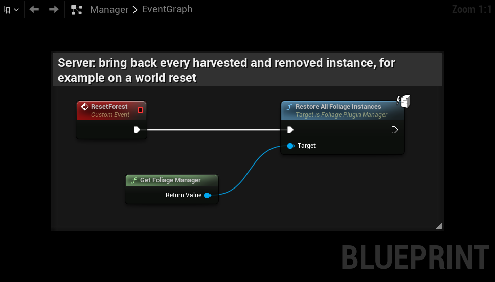

# Blueprint Functions

Besides damage and the [Foliage Actor](/docfiles/reference/foliage-actor) events, the plugin has functions you can call from any Blueprint. They are in the **Foliage Plugin** category.

Functions marked **Server only** do nothing when called on a client. Call them from a Server RPC, see [Multiplayer Harvesting](/docfiles/guides/multiplayer-harvesting).

## Foliage Plugin Library
Available everywhere, no target needed.

| Function | Returns | Description |
|---|---|---|
| **Interact With Foliage** | Boolean | Harvests the foliage instance, Foliage Actor or destructible mesh actor in **Hit** without damage. Returns true if something was harvested. **Server only.** See [Interaction and Pickups](/docfiles/guides/interaction-and-pickups). |
| **Is Harvestable Foliage** | Boolean | True if **Hit** is a foliage instance whose mesh is in the Data Table, or a Foliage Actor with uses left. Works on clients. |
| **Get Foliage Data From Hit** | Boolean, **Out Data** | Gets the [Data Table](/docfiles/reference/data-table-settings) row of the foliage instance or Foliage Actor in **Hit**. Returns false if the hit is not foliage. |
| **Get Foliage Actor From Hit** | Foliage Actor | The Foliage Actor in **Hit**, also when the hit is the actor of its [destructible mesh](/docfiles/guides/destructible-meshes). None if the hit is not a Foliage Actor. |
| **Get Foliage Manager** | Foliage Manager | The Foliage Manager of the world. None until the first foliage component has started. |

## Foliage Plugin Component
Call these on the **FoliagePluginComponent** that holds the instance, for example **Hit Component** from a hit result cast to **FoliagePluginComponent**. The instance index is **Hit Item**.

| Function | Description |
|---|---|
| **Interact With Instance** | Harvests the instance without damage. The same as **Interact With Foliage** for an instance. **Server only.** |
| **Remove Foliage Instance** | Hides the instance without rewards. With **Permanently** on, it is removed for good, otherwise it respawns like a harvested instance. Returns false if the instance is already hidden. **Server only.** |
| **Foliage Get Data** | The component's Data Table row. |

## Foliage Manager
Get the manager with **Get Foliage Manager**.

| Function | Description |
|---|---|
| **Restore All Foliage Instances** | Brings back every hidden and removed instance, spread over several frames. Ignores **Respawn Delay** and the blocking checks. Foliage Actors that still exist are removed first, or returned to the pool. **Server only.** |
| **Get Num Harvested Instances** | The number of hidden and removed instances. On a client, this is what has been replicated so far. |
| **Save Foliage Data to Disk** | Saves right away. See [Saving and Loading](/docfiles/concepts/saving-and-loading). |
| **Is Foliage Data Dirty** | True if something changed since the last save. |
| **Is Saving Foliage Data** | True while a background save is being written. |

For example, to reset the world, call this on the server:

Functions you can override in your own manager are listed in [Custom Foliage Manager](/docfiles/guides/custom-foliage-manager).
