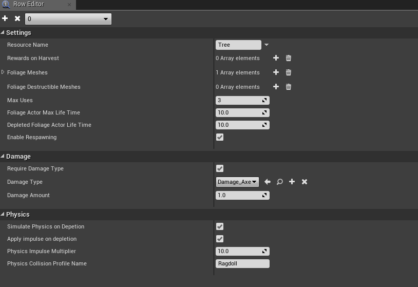

# Data Table Settings

Each row in the Foliage Data Table (row structure **FoliageData**) describes one resource, such as a tree or a rock.

:::note
The screenshot is from an older version. **Foliage Actor Class** has since been added, and **Damage Type** is now the **Valid Damage Types** list.
:::

## Settings
| Column | Default | Description |
|---|---|---|
| **Resource Name** | | A display name for the resource, for example *Tree*. |
| **Rewards on Harvest** | | The rewards given on each harvest. Each reward has a **Reward Name** and a **Number of Rewards** with **Min** and **Max**. You pick the actual amount when you receive the reward, see [Harvesting Foliage](/docfiles/getting_started/harvesting#step-2-add-the-rewards-to-your-inventory). |
| **Foliage Meshes** | | The static meshes that belong to this resource. A foliage instance uses this row when its mesh is in this list. A mesh should only be in one row. |
| **Destructible Meshes** | | Optional destructible versions of the meshes, at the **same index** as in **Foliage Meshes**. Use Geometry Collections. See [Destructible Meshes](/docfiles/guides/destructible-meshes). |
| **Foliage Actor Class** | None | The Foliage Actor spawned when an instance takes damage. **Required.** |
| **Max Uses** | `3` | How many times the resource can be harvested before it is depleted. |
| **Foliage Actor Max Life Time** | `120` | Seconds before a Foliage Actor that was not depleted is destroyed. Extended while a player is nearby. |
| **Depleted Foliage Actor Life Time** | `30` | Seconds a depleted Foliage Actor stays before it is destroyed. |
| **Enable Respawning** | On | When on, the instance respawns after the actor is gone. When off, it is removed for good. |

See [Lifecycle of a Foliage Instance](/docfiles/concepts/lifecycle) for how uses and lifetimes work together.

## Damage
| Column | Default | Description |
|---|---|---|
| **Require Damage Type** | Off | Only accept hits that pass the damage check below. |
| **Valid Damage Types** | | The damage types that can harvest this resource. |
| **Damage Amount** | `1` | The minimum damage per hit. |

See [Damage Types](/docfiles/guides/damage-types).

## Physics
| Column | Default | Description |
|---|---|---|
| **Simulate Physics on Depletion** | Off | Simulate physics when depleted, for example a falling tree. Ignored if the resource has a destructible mesh. |
| **Apply Impulse on Depletion** | Off | Push the mesh with an impulse when it starts simulating. |
| **Physics Impulse Multiplier** | `10` | Strength of the impulse. |
| **Physics Collision Profile Name** | `None` | Collision profile to use while simulating. `None` keeps the current profile. |

See [Simulating Physics](/docfiles/guides/simulating-physics).
