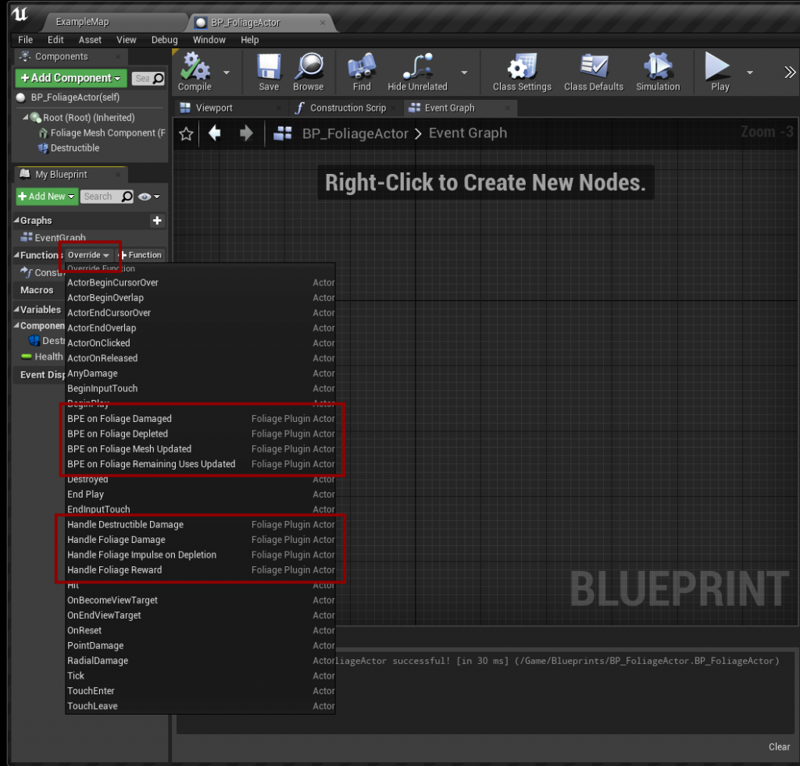

# Foliage Actor

The **FoliagePluginActor** is the Actor that replaces a foliage instance. Create a Blueprint subclass of it and set it as **Foliage Actor Class** in the [Data Table](/docfiles/reference/data-table-settings).

Its events and functions are listed under **Override** in the **My Blueprint** panel:

## Components
| Component | Description |
|---|---|
| **Root** | Scene root. |
| **Foliage Mesh** | Static mesh component. The plugin sets it to the instance's mesh. |

Add a **Geometry Collection Component** (UE5) or **Destructible Component** (UE4) yourself if you use [destructible meshes](/docfiles/guides/destructible-meshes).

## Events
| Event | Runs on | Called when |
|---|---|---|
| **BPE On Foliage Damaged** | Server | The actor was harvested. Receives the damage, instigator, causer, damage type and rewards. |
| **BPE On Foliage Remaining Uses Updated** | Server and clients | The remaining uses changed. |
| **BPE On Foliage Mesh Updated** | Server and clients | The mesh was set, right after the actor was spawned. |
| **BPE On Foliage Depleted** | Server and clients | The remaining uses reached 0. Called once. |

The same events are also available as the bindable delegates **On Foliage Remaining Uses Updated**, **On Foliage Mesh Updated** and **On Foliage Depleted**, for example to listen from a widget.

## Overridable functions
| Function | Default behavior | Override to |
|---|---|---|
| **Handle Foliage Damage** | Checks the damage type, gives the reward, reduces the remaining uses and breaks the destructible mesh. | Change when a hit counts, for example with [health](/docfiles/guides/health). Call the parent to keep the default behavior. |
| **Handle Foliage Reward** | Calls **On Foliage Harvested** on the Instigator and the Damage Causer. Returns false if neither implements the interface. | Give rewards in your own way. If you override it, call **On Foliage Harvested** yourself if you still want the interface to be used. |
| **Handle Destructible Damage** | Breaks the destructible mesh at the hit location. Runs on server and clients. | Break the mesh in your own way. |
| **Handle Foliage Impulse on Depletion** | Pushes the mesh near its top in a random direction, scaled by its mass and **Physics Impulse Multiplier**. | Make it fall in a specific direction, for example away from the player. |

**Handle Foliage Damage** and **Handle Foliage Reward** only run on the server.

## Functions
| Function | Description |
|---|---|
| **Foliage Get Data** | Returns the actor's row from the Data Table. |
| **Foliage Get Remaining Uses** | Returns the remaining uses. |
| **Foliage Get Reward** | Returns **Rewards on Harvest** from the row. |
| **Reduce Remaining Uses** | Reduces the remaining uses. Server only. |
| **Add Remaining Uses** | Adds remaining uses. Server only. |
| **Set Remaining Uses** | Sets the remaining uses. Server only. |

**Reduce**, **Add** and **Set Remaining Uses** can be called from inside your Foliage Actor Blueprint.
