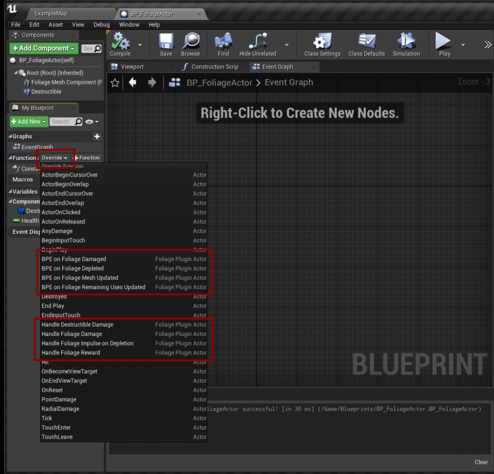
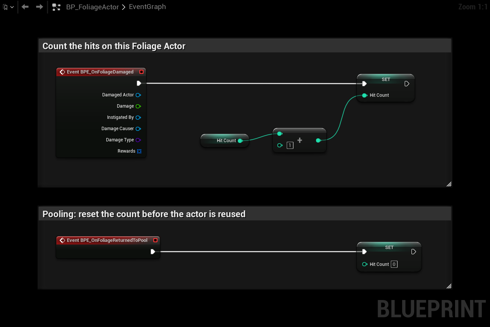

# Foliage Actor

The **FoliagePluginActor** is the Actor that replaces a foliage instance. Create a Blueprint subclass of it and set it as **Foliage Actor Class** in the [Data Table](/docfiles/reference/data-table-settings).

Its events and functions are listed under **Override** in the **My Blueprint** panel:

## Components
| Component | Description |
|---|---|
| **Root** | Scene root. |
| **Foliage Mesh** | Static mesh component. The plugin sets it to the instance's mesh. |

Add a **Geometry Collection Component** yourself if you use [destructible meshes](/docfiles/guides/destructible-meshes).

## Events
| Event | Runs on | Called when |
|---|---|---|
| **BPE On Foliage Damaged** | Server | The actor was harvested. Receives the damage, instigator, causer, damage type and rewards. |
| **BPE On Foliage Remaining Uses Updated** | Server and clients | The remaining uses changed. |
| **BPE On Foliage Mesh Updated** | Server and clients | The mesh was set, right after the actor was spawned. |
| **BPE On Foliage Depleted** | Server and clients | The remaining uses reached 0. Called once. |
| **BPE On Foliage Interacted** | Server | The actor was harvested with **Interact** instead of damage. Receives the instigator, causer and rewards. See [Interaction and Pickups](/docfiles/guides/interaction-and-pickups). |
| **BPE On Foliage Returned To Pool** | Server and clients | The actor was returned to the pool. Only used with [actor pooling](#actor-pooling). |

The same events are also available as the bindable delegates **On Foliage Remaining Uses Updated**, **On Foliage Mesh Updated** and **On Foliage Depleted**, for example to listen from a widget.

## Overridable functions
| Function | Default behavior | Override to |
|---|---|---|
| **Handle Foliage Damage** | Checks the damage type, gives the reward, reduces the remaining uses and breaks the destructible mesh. | Change when a hit counts, for example with [health](/docfiles/guides/health). Call the parent to keep the default behavior. |
| **Handle Foliage Reward** | Calls **On Foliage Harvested** on the first of the Instigator, the Instigator's Pawn and the Damage Causer that implements the interface. Returns false if none of them does. Also called by **Interact**. | Give rewards in your own way. If you override it, call **On Foliage Harvested** yourself if you still want the interface to be used. |
| **Handle Destructible Damage** | Breaks the destructible mesh at the hit location. Runs on server and clients. | Break the mesh in your own way. |
| **Handle Foliage Impulse on Depletion** | Pushes the mesh near its top in a random direction, scaled by its mass and **Physics Impulse Multiplier**. | Make it fall in a specific direction, for example away from the player. |

**Handle Foliage Damage** and **Handle Foliage Reward** only run on the server.

## Functions
| Function | Description |
|---|---|
| **Foliage Get Data** | Returns the actor's row from the Data Table. |
| **Foliage Get Remaining Uses** | Returns the remaining uses. |
| **Foliage Get Reward** | Returns **Rewards on Harvest** from the row. |
| **Get Geometry Collection Actor** | Returns the actor that shows the [destructible mesh](/docfiles/guides/destructible-meshes), or none if the mesh has no destructible version. |
| **Is In Pool** | True while the actor is unused in the [pool](#actor-pooling). |
| **Interact** | Harvests the actor once without damage: gives the rewards, reduces the remaining uses by 1 and calls **BPE On Foliage Interacted**. Returns false if **Allow Interaction** is off or no uses are left. Server only. |
| **Reduce Remaining Uses** | Reduces the remaining uses. Server only. |
| **Add Remaining Uses** | Adds remaining uses. Server only. |
| **Set Remaining Uses** | Sets the remaining uses. Server only. |

**Reduce**, **Add** and **Set Remaining Uses** can be called from inside your Foliage Actor Blueprint.

## Actor pooling
With **Enable Actor Pooling** on in the [Plugin Settings](/docfiles/reference/plugin-settings#performance), a Foliage Actor that is done is not destroyed. It is hidden, its collision is turned off and it is kept for the next instance of the same Foliage Actor class. This saves spawning and destroying actors when players harvest a lot.

When the actor returns to the pool, the plugin resets what it changed itself: the remaining uses, physics, collision, materials, the mesh transform, and the destructible mesh. Then it calls **BPE On Foliage Returned To Pool** on the server and every client.

:::warning
**Begin Play** only runs the first time the actor is spawned. If your Blueprint changes something on the actor, for example spawns effects, attaches components or sets variables, reset it in **BPE On Foliage Returned To Pool**. Use **BPE On Foliage Mesh Updated** for setup that should run each time the actor is used.
:::

In this example the Foliage Actor counts its hits in an integer variable **Hit Count**. Without the reset, a reused actor would start counting from the previous tree's value:

At most **Max Pooled Actors Per Class** unused actors are kept per class. Actors beyond that are destroyed as usual.
