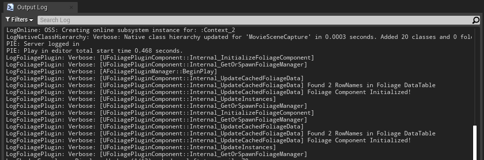

# Logging and Debugging

## Log category
The plugin logs to the **LogFoliagePlugin** category. Warnings and errors are always shown. To see what the plugin does "under the hood", enable verbose logging.

For a single session, use the console command:

```
Log LogFoliagePlugin Verbose
```

To keep it enabled, add this to `Config/DefaultEngine.ini` in your project. If the file already has a `[Core.Log]` section, add only the second line to it:

```ini
[Core.Log]
LogFoliagePlugin=Verbose
```

Example of verbose output:



## On-screen debug messages
With **Enable Debugging** on in the [Plugin Settings](/docfiles/reference/plugin-settings), the plugin prints problems on screen and to the log, and draws a sphere for every despawn and respawn blocking check: green when an object blocks, red when it does not. On-screen messages are not shown in Shipping builds.

## Messages

| Message | Meaning |
|---|---|
| *No foliage DataTable defined in Project Settings!* | **Foliage Data Table** is not set. See [Setting up Foliage](/docfiles/getting_started/setup#step-3-assign-the-data-table-in-the-project-settings). |
| *Failed initializing foliage component! Could not find any matching data* | A foliage component's mesh is not in **Foliage Meshes** in any row. Expected for foliage you do not want to harvest. |
| *On Point Damage: Failed to Initialize Foliage Component, Check the Foliage DataTable!* | A foliage instance took damage, but its mesh is not in the Data Table. |
| *Foliage Actor class is invalid! Check your data table settings!* | The row has no **Foliage Actor Class**. |
| *On Point Damage: Failed spawning a Foliage Actor!* | The Foliage Actor could not be spawned. |
| *Foliage successfully harvested, but Instigator or DamageCauser does not implement the FoliageInterface!* | Nothing received the reward. See [Foliage Plugin Interface](/docfiles/reference/foliage-plugin-interface). |
| *Found a Destructible Mesh but no Geometry Collection Component found on (X)* | The row has a destructible mesh, but the Foliage Actor has no Geometry Collection Component (UE5) or Destructible Component (UE4). |
| *Saved Foliage Component Data to Disk* / *Saving Foliage Component Data Failed!* | Result of an automatic or manual save. |
| *Loaded foliage data from disk* / *Failed loading foliage data from disk* | Result of loading the save when the game starts. |

## Finding the log file
Log files are written to your project's `Saved/Logs` folder.
