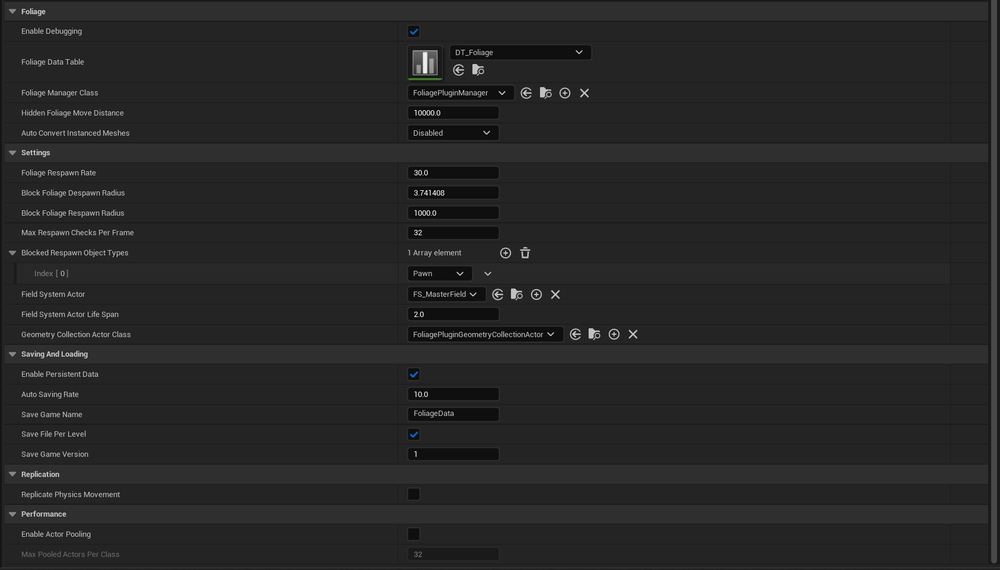

# Plugin Settings

The settings are in **Project Settings → Game → Foliage Plugin** and are saved in `DefaultGame.ini`.

:::note
In the screenshot, **Field System Actor** is still set to `FS_MasterField` from an older version. The default is now **FoliagePluginFieldSystemActor**.
:::

## Foliage
| Setting | Default | Description |
|---|---|---|
| **Enable Debugging** | On | Shows on-screen debug messages and draws the blocking checks. See [Logging and Debugging](/docfiles/reference/logging). Turn it off before you ship. |
| **Foliage Data Table** | None | The Data Table with your resources. Its row structure must be **FoliageData**. See [Data Table Settings](/docfiles/reference/data-table-settings). |
| **Foliage Manager Class** | FoliagePluginManager | The manager class that is spawned automatically. See [Custom Foliage Manager](/docfiles/guides/custom-foliage-manager). |
| **Hidden Foliage Move Distance** | `10000` | How far down, in units on the Z axis, an instance is moved when it is hidden. |
| **Auto Convert Instanced Meshes** | Disabled | Converts instanced mesh components whose mesh is in the Data Table into **FoliagePluginComponent** when their level loads, so you do not have to change the **Component Class**. **Painted Foliage Only** converts foliage painted with the Foliage tool. **All Instanced Static Meshes** also converts other Instanced and Hierarchical Instanced Static Mesh components. See [Automatic conversion](/docfiles/guides/pcg-and-instanced-meshes#automatic-conversion). |

## Settings
| Setting | Default | Description |
|---|---|---|
| **Foliage Respawn Rate** | `60` | Seconds between respawn attempts. Minimum 10. See [respawning](/docfiles/concepts/lifecycle#6-the-instance-respawns). |
| **Block Foliage Despawn Radius** | `1000` | A Foliage Actor is not destroyed while an object of a blocked type is within this radius. |
| **Block Foliage Respawn Radius** | `1000` | An instance does not respawn while an object of a blocked type is within this radius. |
| **Max Respawn Checks Per Frame** | `32` | The maximum number of respawn blocking checks per frame. Remaining respawns continue in the next frames, so a large number of respawns does not stall the server. Minimum 1. |
| **Blocked Respawn Object Types** | Pawn | Object types that block both despawning and respawning. Leave empty to never block. |
| **Field System Actor** | `FoliagePluginFieldSystemActor` | The Field System Actor spawned to break [Geometry Collections](/docfiles/guides/destructible-meshes#field-system-actor). |
| **Field System Actor Life Span** | `2` | Seconds a spawned Field System Actor stays before it is destroyed. Minimum 0.1. |
| **Geometry Collection Actor Class** | `FoliagePluginGeometryCollectionActor` | The actor spawned to show a [destructible mesh](/docfiles/guides/destructible-meshes). Set your own child class here. |

## Saving and Loading
| Setting | Default | Description |
|---|---|---|
| **Enable Persistent Data** | Off | Saves hidden and removed instances between sessions. |
| **Auto Saving Rate** | `60` | Seconds between automatic saves. Minimum 5. |
| **Save Game Name** | `FoliageData` | Save slot name. |
| **Save File Per Level** | On | Adds the level name to the save slot, so every level has its own save file. |
| **Save Game Version** | `1` | A save with a different version is ignored and overwritten. |

See [Saving and Loading](/docfiles/concepts/saving-and-loading).

## Replication
| Setting | Default | Description |
|---|---|---|
| **Replicate Physics Movement** | Off | Replicates the movement of depleted actors that simulate physics. Costs bandwidth, only turn it on if the positions matter for gameplay. |

## Performance
| Setting | Default | Description |
|---|---|---|
| **Enable Actor Pooling** | Off | Reuses Foliage Actors instead of destroying them and spawning new ones. See [Actor pooling](/docfiles/reference/foliage-actor#actor-pooling). |
| **Max Pooled Actors Per Class** | `32` | The maximum number of unused Foliage Actors kept per Foliage Actor class. Actors beyond this are destroyed. Minimum 1. |
