# Multiplayer Survival Game Template (MSGT)

:::caution Outdated
This tutorial was made for an older version of the Multiplayer Survival Game Template and may need changes for newer versions.
:::

## Step 1: Create the Data Table
Create a Data Table with **FoliageData** as the row structure.

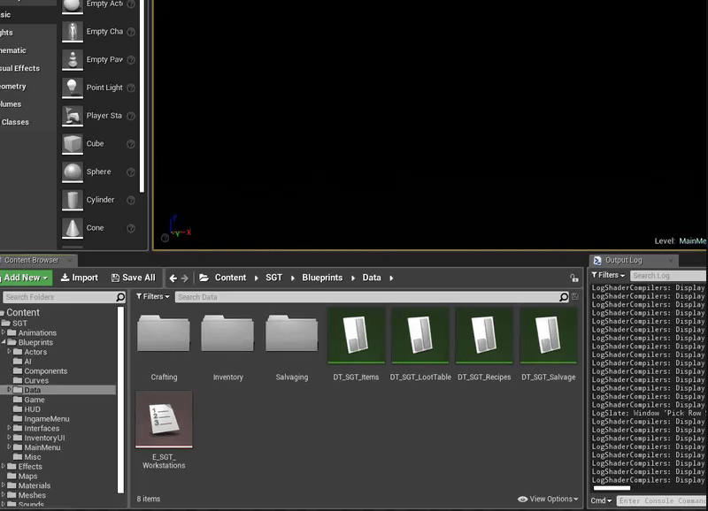

## Step 2: Create the Foliage Actor
Create a Blueprint class with **FoliagePluginActor** as the parent class.

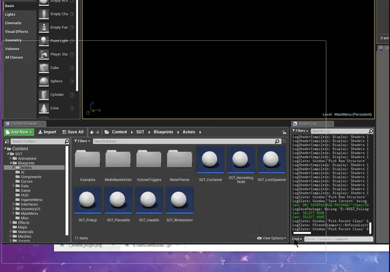

## Step 3: Assign the Data Table in the Project Settings
Set the Data Table in **Project Settings → Game → Foliage Plugin**. In newer plugin versions, the Foliage Actor is set per resource with **Foliage Actor Class** in the Data Table.

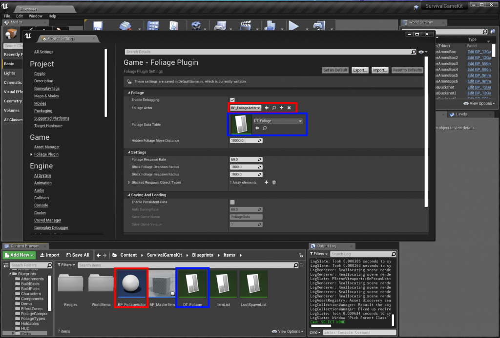

## Step 4: Change the component class
Set **Component Class** to **FoliagePluginComponent** on your foliage types.

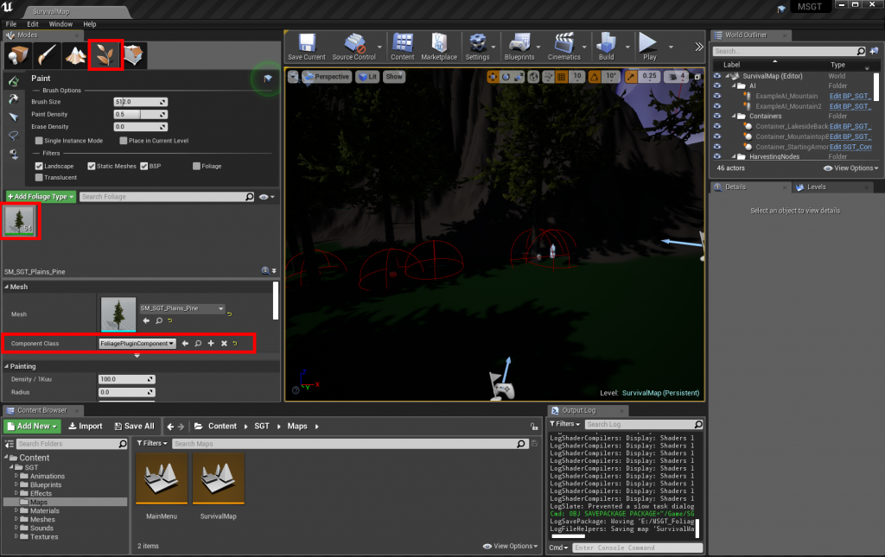

## Step 5: Add a tree resource

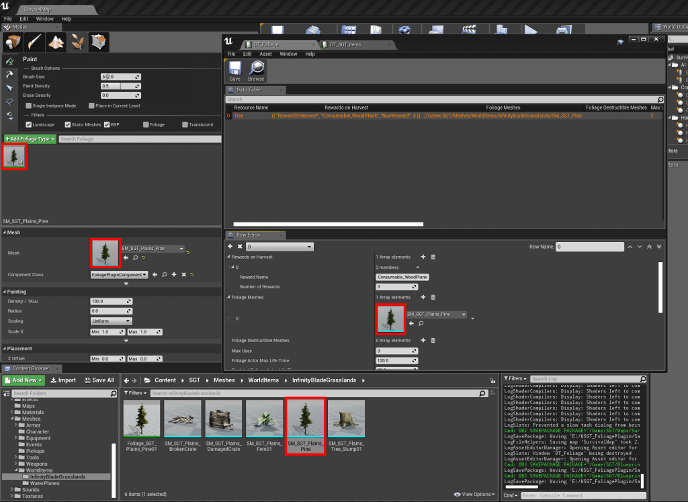

## Step 6: Implement the interface in SurvivalController
Add the **Foliage Plugin Interface** to the **SurvivalController** Blueprint.

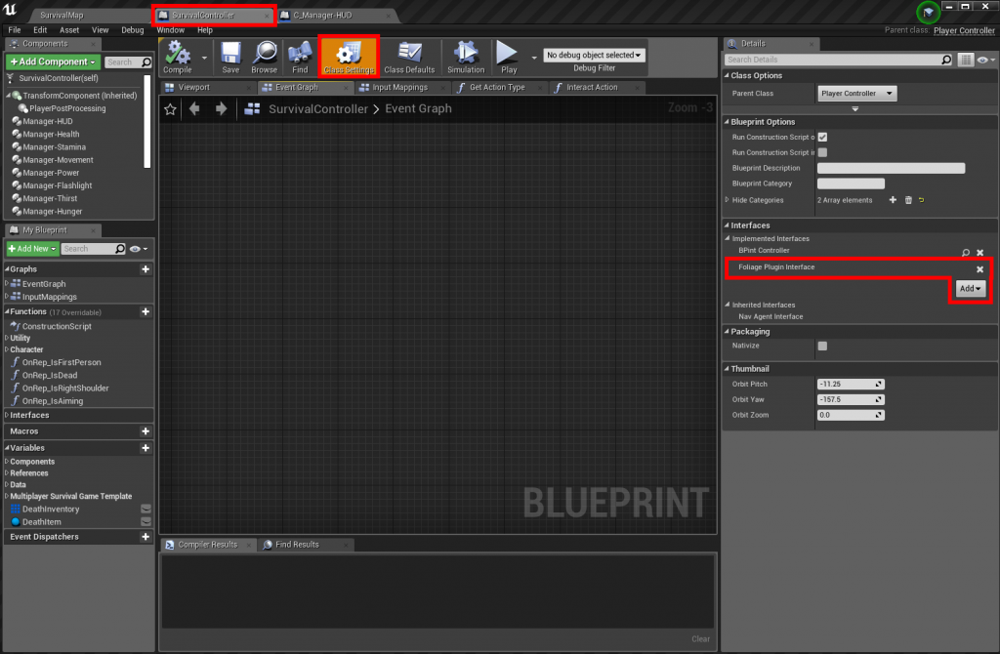

Right-click in the SurvivalController Event Graph and add the interface event. This example adds the foliage rewards to the inventory:

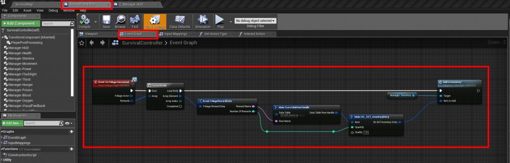

## Step 7: Create the harvest event
In the SurvivalController Event Graph, create a new event as below:

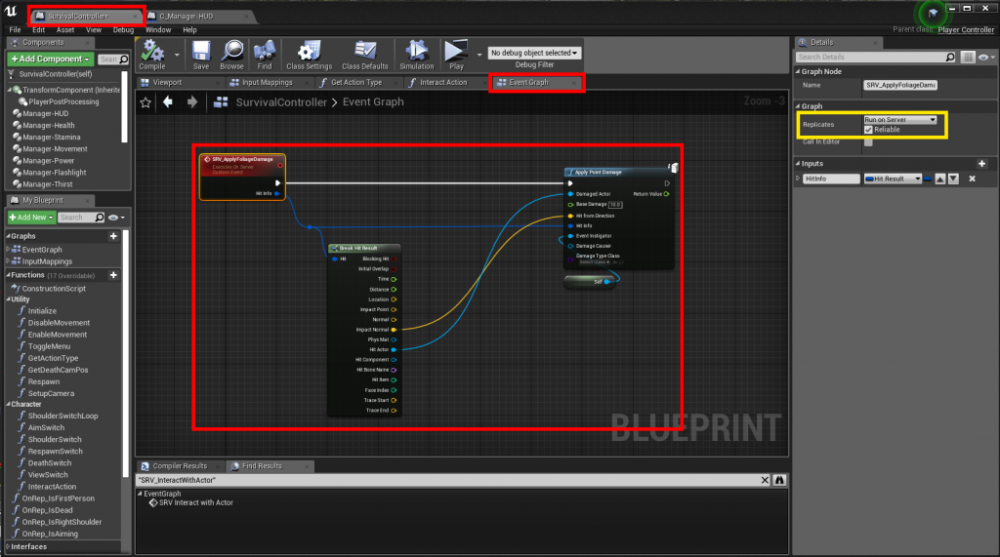

## Step 8: Output the hit result from the interaction trace
Open the **C_Manager-HUD** component and change the **InteractiveTrace** function to output the **Hit Result**:

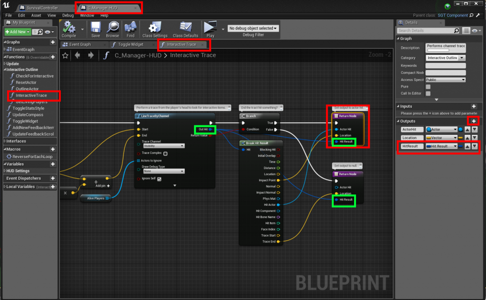

In the **GetActionType** function (SurvivalController), add an input of type **Hit Result**:

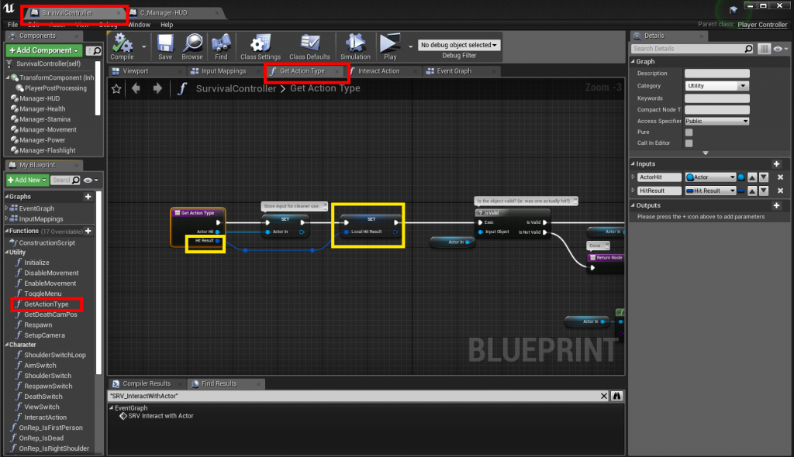

Connect the new Hit Result in the **InteractAction** function (SurvivalController):

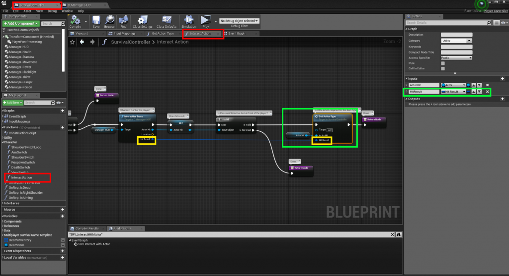

## Step 9: Call the harvest event
Change **GetActionType** to call the event you created in Step 7, as shown in yellow:

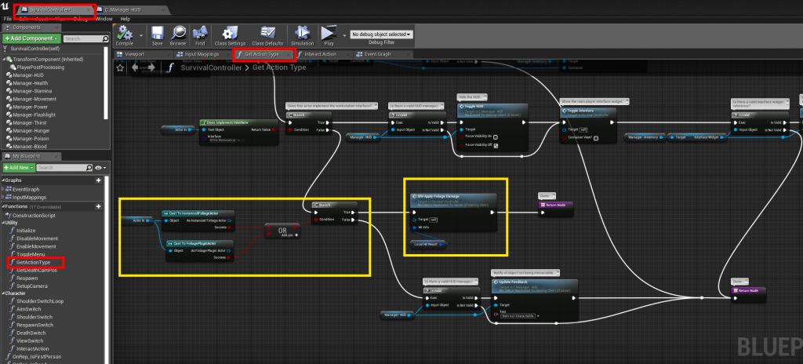
