# Survival Game Kit v1

:::caution Outdated
This tutorial was made for an older version of the Survival Game Kit and may need changes for newer versions.
:::

import ReactPlayer from 'react-player'

## Video demonstration
<ReactPlayer url='https://www.youtube.com/watch?v=jcDR2N0pMD4' />

## Step 1: Create the Data Table
Create a Data Table with **FoliageData** as the row structure.

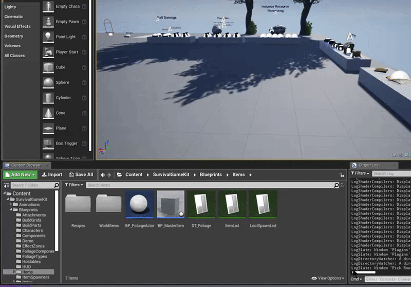

## Step 2: Create the Foliage Actor
Create a Blueprint class with **FoliagePluginActor** as the parent class.

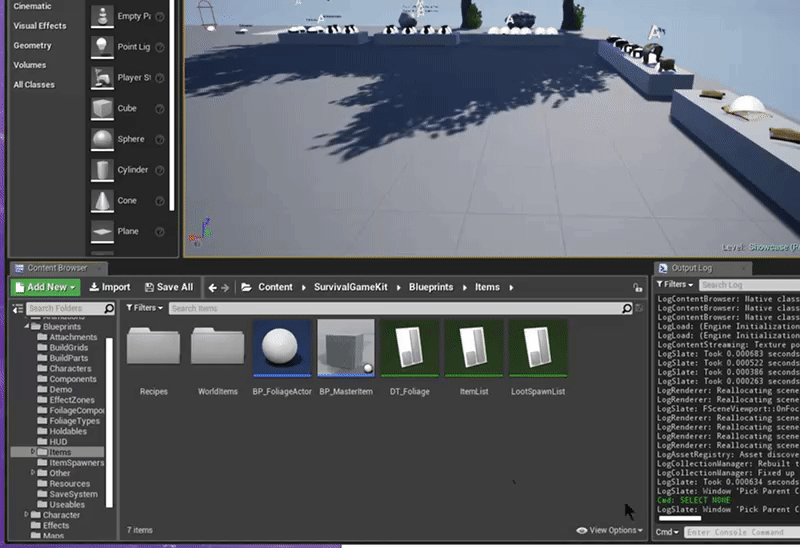

## Step 3: Assign the Data Table in the Project Settings
Set **Foliage Data Table** in **Project Settings → Game → Foliage Plugin**. The Foliage Actor is set per resource in the Data Table, not here.

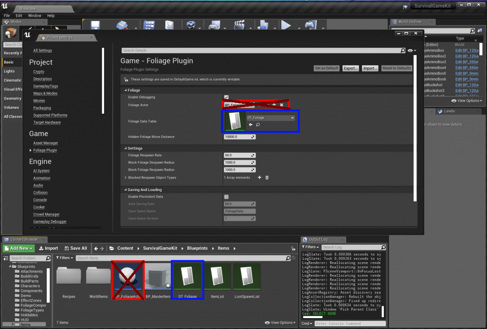

## Step 4: Change the component class
Set **Component Class** to **FoliagePluginComponent** on your foliage types.

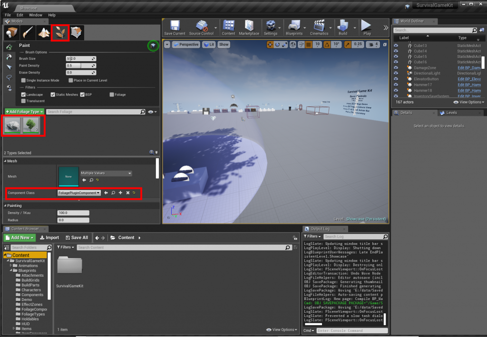

## Step 5: Add a tree resource
Add a tree to the Data Table:

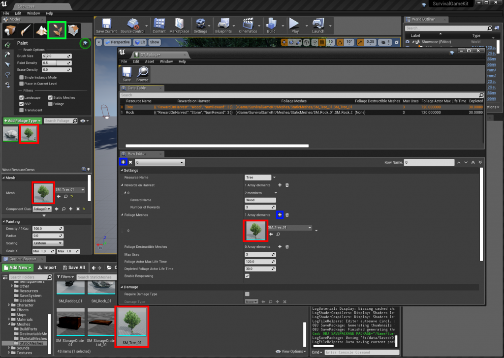

Set **Foliage Actor Class** to the Foliage Actor from Step 2:

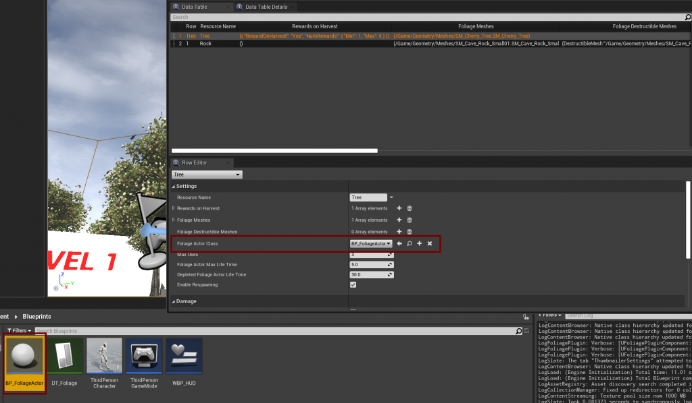

## Step 6: Add a rock resource

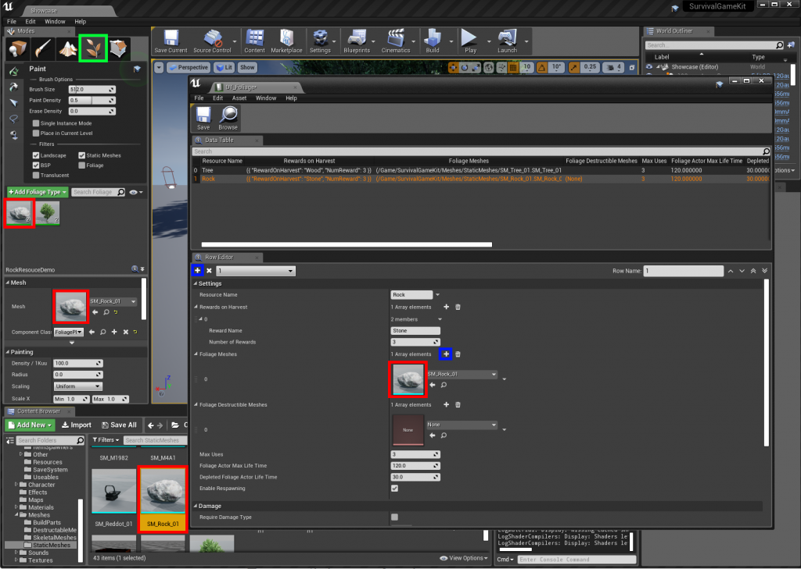

## Step 7: Implement the interface on the character
In **BP_SurvivalCharacter**, add the **Foliage Plugin Interface**.

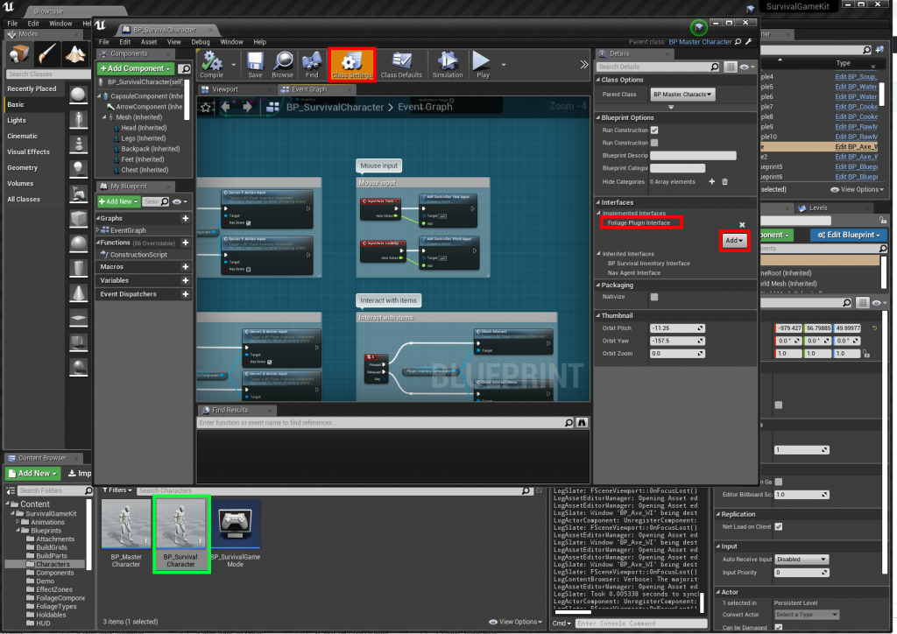

Add the harvested resources to the inventory:

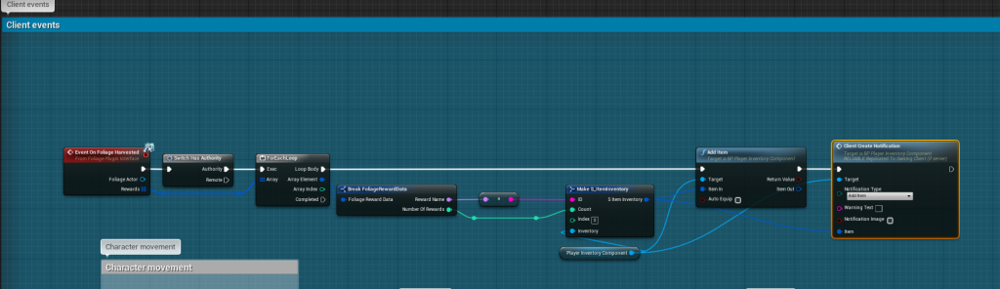

## Step 8: Harvest with melee weapons
Open **BP_MasterMeleeWeapon** (`/Blueprints/Holdables/BP_MasterMeleeWeapon`) and change the **Give Damage Once** function as below:

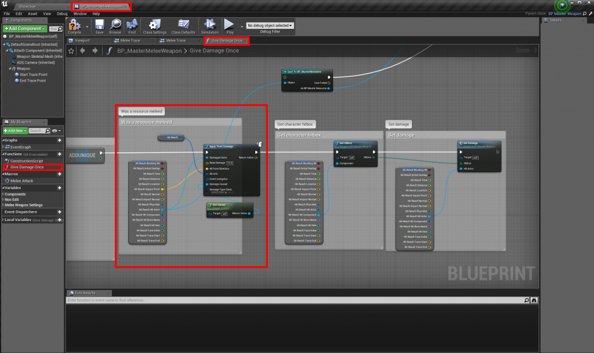

## Step 9: Harvest with the interact key
Open **BP_PlayerInventoryComponent** (`/Blueprints/Components`) and change the **Is inventory actor?** macro:

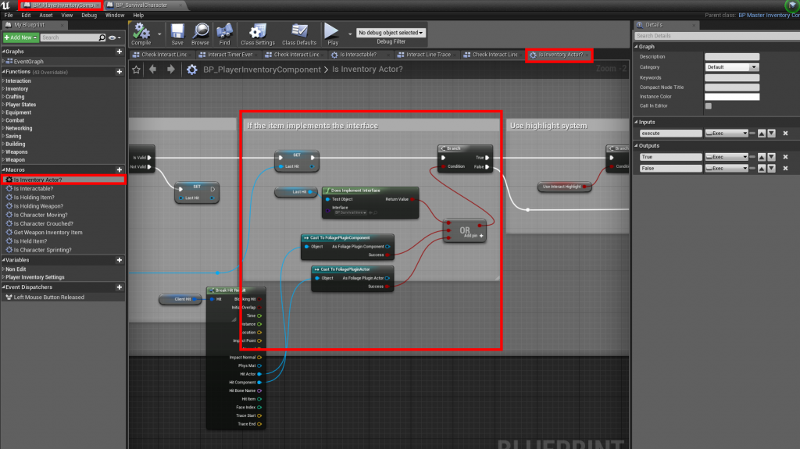

Then change the **Is Interactable?** macro:

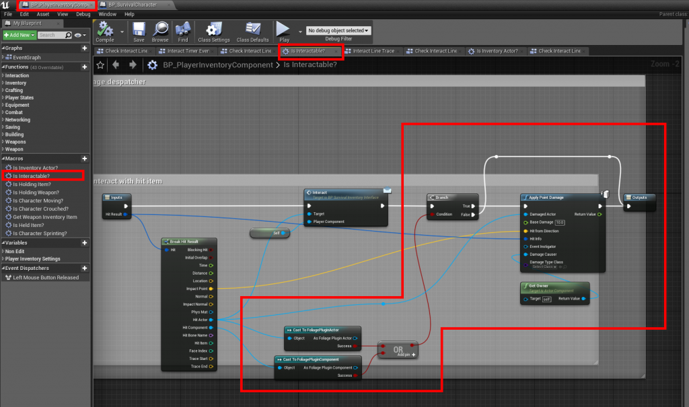
